# The Legend of Zelda — Port Commodore 64

[](https://github.com/vedix95/ZELDAC64/releases)
[](https://github.com/vedix95/ZELDAC64/actions)
[](https://en.wikipedia.org/wiki/Commodore_64)
[](https://sourceforge.net/projects/acme-crossass/)
[](docs/audio/)
[](LICENSE)

Une recréation fidèle, intégrale et spectaculaire du classique **The Legend of Zelda** (1986) sur **Commodore 64**, programmée en assembleur pur MOS 6510 pour le cross-assembleur [ACME](https://sourceforge.net/projects/acme-crossass/) et optimisée pour l'émulateur [VICE](https://vice-emu.sourceforge.io/) ainsi que le matériel réel.

> *Ce projet est la création d'un passionné d'informatique rétro réalisée à l'aide de son IA préférée issue de chez Google.*

---

## 🌟 La Vitrine du Jeu : Points Forts

* 🏰 **L'intégralité d'Hyrule sur C64 (Fidélité 1:1 NES)** :
  * **128 salles d'Overworld** reproduites tuile par tuile avec tous les secrets officiels, grottes d'ermites, fées et boutiques.
  * **Les 9 Donjons complets** (Niveaux 1 à 9) avec leurs labyrinthes, portes à clés, énigmes de blocs poussables, et l'affrontement final contre **Ganon**.
  * **Tous les Boss originaux** : Aquamentus, Dodongo, Manhandla, Gleeok, Digdogger, Gohma et Ganon.
* 📜 **Introduction & Prologue Cinématique 1:1 NES** :
  * **Écran Titre & Cascade Animée** : Palette authentique de l'aube (ciel rose ouvert `COL_LRED`, falaises rocheuses grises de Palette 0, lettres ZELDA cramoisies `COL_RED` bordées d'or, étoile scintillante Sprite 0 et vagues descendantes Sprites 1..4).
  * **Récit d'Hyrule en Scrolling Matériel 50 Hz** : Défilement vertical au pixel près via le registre VIC-II `$D011` dans son cadre de pierre centré avec masquage invisible en bordure (`RSEL=0`).
  * **Défilé des 35 Trésors & Reliques** : Présentation simultanée sur deux colonnes avec sprites matériels VIC-II pleine résolution.
  * **Défilé du Bestiaire d'Hyrule Multimonstres** : Moteur dynamique à 6 slots simultanés avec animations de marche 2 poses cadencées à 8 frames et couleurs individuelles.
* ⚡ **Cartouche Magic Desk 512 Ko (Zéro Temps de Chargement)** :
  * Déballage du moteur en 0,2 seconde au démarrage.
  * Streaming instantané des salles, donjons, graphismes et overlays cartouche sans aucune latence disquette.
* 🗡️ **Système de Combat & Arsenal Complet** :
  * Link manie l'épée avec projection de rayons à pleine vie, bombes avec animation en 3 phases, arcs, bougies, flûte magique, baguette et boomerangs en tête chercheuse.
  * Échelle de franchissement autonome (Sprite 2) et radeau de traversée fluviale.
* 👑 **Sous-Écran d'Inventaire Haute Résolution & Grande Pyramide** :
  * **Grande Pyramide de la Triforce** : 8 fragments biseautés s'assemblant en un triangle doré équilatéral plein.
  * **Grille d'objets secondaires 4×2** avec navigation fluide au joystick et cadre centré sans aucun débordement.
  * **Carte topologique d'Hyrule à 6 biomes** avec indicateur de position clignotant monocase.
* 🎶 **Moteur Audio SID & Dual SID Stéréo ($D420)** :
  * Synthèse analogique 3 voix sur puce **MOS SID 6581/8580** (mélodie Pulse, contre-chant Triangle/Sawtooth, basse profonde et percussions Noise).
  * Mode **Dual SID stéréo** dynamique avec chorus spatialisé et thème étendu du **Donjon 9 (Death Mountain)**.
  * File d'attente sonore sérialisée éliminant toute coupure entre SFX, carillons de secrets et mélodies.

---

## 📸 Le Jeu en Action

### Introduction & Cinématiques 1:1 NES

| Écran Titre & Cascade (Aube) | Récit d'Hyrule (Cadre Pierre) | Défilé des 35 Trésors (2 Colonnes) | Bestiaire Multimonstres (6 Slots) |
| :---: | :---: | :---: | :---: |
|  |  |  |  |

| Comparatif 1:1 : Original NES vs Port Commodore 64 |
| :---: |
| [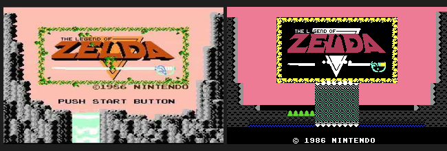](docs/images/compare_intro.png) |

### Aventure & Combats Épiques

| Écran Titre & Cascade Animée | Exploration de l'Overworld | Combat contre Aquamentus |
| :---: | :---: | :---: |
|  |  |  |

| Labyrinthe des Donjons | Antre Sombre de Ganon (Donjon 9) | Grotte Secrète de l'Épée |
| :---: | :---: | :---: |
|  | 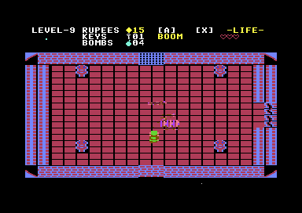 | 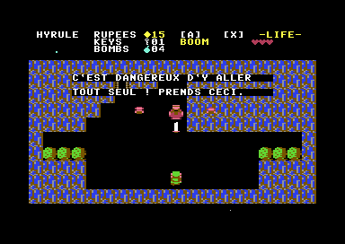 |

### Menus d'Inventaire & Carte du Monde

| Grande Pyramide de la Triforce | Arsenal d'Armes & Reliques | Carte Topologique 6 Biomes |
| :---: | :---: | :---: |
| 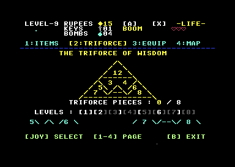 | 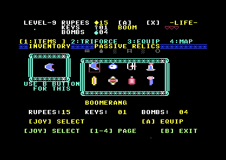 | 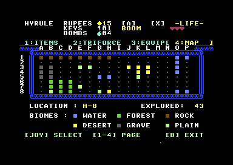 |

### Bestiaire Authentique & Grands Boss Multi-Sprites

| Boss Dodongo (32×16 px) | Boss Manhandla Quadrilobé | Chevaliers Darknuts (D3) |
| :---: | :---: | :---: |
| 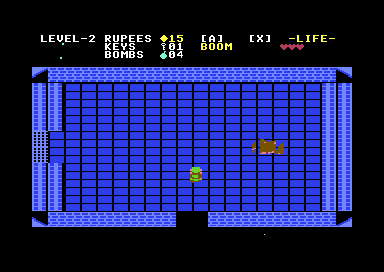 | 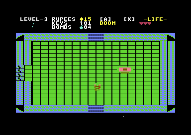 | 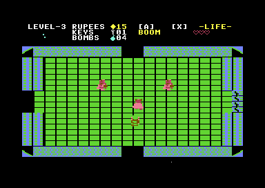 |

| Goriyas Rouges (D1) | Serpents Ropes (D2) | Dragon Aquamentus (24×32 px) |
| :---: | :---: | :---: |
| 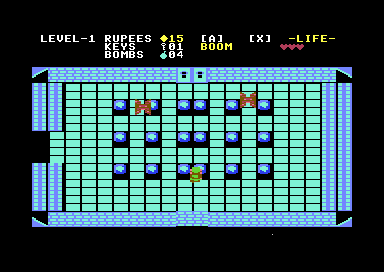 | 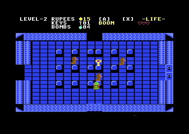 | 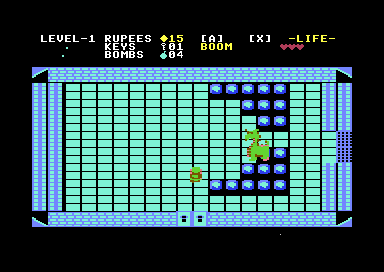 |

---

## 🎨 Atlas Graphique & Planches de Contact

Le jeu intègre un outil d'extraction visuel autonome ([`tools/export_assets_sheet.py`](tools/export_assets_sheet.py)) générant des planches de contact pixel-art haute résolution (mise à l'échelle fidèle 2:1 respectant le ratio d'aspect des pixels multicolores C64) avec métadonnées et cadencements :

### Planche Maîtresse Consolidée (Master Atlas)
L'affiche globale rassemble les 16 tuiles mondes, 16 tuiles donjons, 31 sprites du héros Link, 125 monstres et boss, 27 objets et 36 cycles d'animation décomposés :

[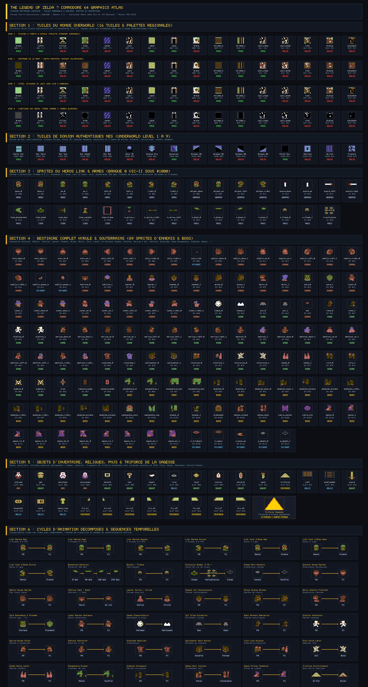](docs/images/atlas_all_assets.png)

### Planches Dédiées par Catégorie
* 🗺️ [**Planche des Tuiles (Overworld 4 zones & Donjons)**](docs/images/sheet_tiles.png) : 16 tuiles sous 4 palettes régionales (Plaines, Montagne, Côte, Cimetière) et 16 dalles de donjon avec statuts de collision (`SOLID` / `PASS` / `WATER`).
* 🗡️ [**Planche de Link & Arsenal**](docs/images/sheet_sprites_link.png) : Déplacements 4 directions, poses d'attaque à l'épée, port d'items, boomerangs 360°, flammes et flèches.
* 👾 [**Planche du Bestiaire Monstres & Boss**](docs/images/sheet_sprites_enemies.png) : 125 sprites des monstres terrestres (Octorok, Moblin, Lynel 4-dir, Tektite, Leever, Peahat, Armos, Ghini, Zora), volants, bêtes de donjons et grands boss.
* 💎 [**Planche des Objets, Reliques & PNJs**](docs/images/sheet_sprites_items.png) : Armes, reliques passives, PNJs et vitrine de la pyramide assemblée de la Triforce.
* 🎞️ [**Planche des Cycles d'Animation Décomposés**](docs/images/sheet_animations.png) : 36 séquences animées présentées frame par frame avec cadencements (`2 Frames @ 8 FPS`, `3 Phases @ 24 Ticks`).

*(Pour regénérer l'ensemble des planches en quelques secondes : tapez simplement `make atlas`).*

---

## 💾 Téléchargement Rapide & Lancement

1. Téléchargez la dernière version de la cartouche : **[`zelda.crt` (Dernière Release)](https://github.com/vedix95/ZELDAC64/releases/latest)**.
2. Lancez directement la cartouche dans [VICE](https://vice-emu.sourceforge.io/) :
   ```bash
   x64sc -cartcrt zelda.crt
   ```
*(En mode Dual SID stéréo : `x64sc -cartcrt zelda.crt -sidextra 1 -sid2address 0xd420`)*

### Compilation depuis les Sources
```bash
# Dépendances requises : ACME cross-assembler, VICE et Python 3
make          # Assemble et génère build/zelda.crt (Magic Desk 512 Ko)
make run      # Lance le jeu immédiatement dans l'émulateur VICE
make atlas    # Génère toutes les planches graphiques PNG dans build/
make maps     # Rendu haute définition des cartes de l'Overworld et des 9 donjons
```

---

## 🕹️ Contrôles du Jeu

Le jeu se pilote au **Joystick branché sur le Port 2** (ou pavé numérique / clavier sous émulateur) :

| Commande | Action |
| :--- | :--- |
| **Direction Joystick** / Pavé numérique | Déplacements de Link (Haut, Bas, Gauche, Droite) |
| **Bouton Feu** / Touche `X` | Coup d'épée (et tir d'épée laser si santé pleine) |
| Touche `A` | Utiliser l'objet secondaire actif équipé (Boomerang, Bombe, Arc...) |
| Touche `B` | Ouvrir / Fermer le sous-écran d'inventaire |
| Touche `3` | Basculer en temps réel entre **Mono SID ($D400)** et **Dual SID Stéréo ($D420)** |
| Touche `D` | Menu de téléportation et de diagnostic (Debug) |
| `Espace` / `Entrée` | Passer l'introduction cinématique |

---

## 🎵 Bande-Sonore SID Authentique

La bande originale a été transcrite avec précision pour les 3 oscillateurs du SID :

| Piste & Ambiance | Description | Écoute directe |
| :--- | :--- | :---: |
| 🛡️ **Thème Overworld (Aventure)** | La mélodie héroïque mythique avec basse bondissante sur Voix 3. | [Écouter MP3](docs/audio/zelda_overworld.mp3) |
| 🗝️ **Thème des Donjons (Underworld)** | Arpèges entrelacés en onde Pulse 50% et basse sourde d'angoisse. | [Écouter MP3](docs/audio/zelda_dungeon.mp3) |
| 📜 **Thème d'Introduction & Titre** | Cascade animée, blason et défilement de la Légende d'Hyrule. | [Écouter MP3](docs/audio/zelda_intro.mp3) |

---

## 📚 Documentation Technique Approfondie

Pour les développeurs, passionnés d'assembleur 6510 et curieux de l'architecture matérielle :
* 📖 [**Documentation d'Architecture Système (`DOCUMENTATION.md`)**](./DOCUMENTATION.md) : Organisation de la mémoire 64 Ko, streaming cartouche Magic Desk 512 Ko, multiplexeur de sprites VIC-II et moteur sonore.
* 🐛 [**Registre des Anomalies & Correctifs (`bugs.md`)**](./bugs.md) : Historique des 23 bugs résolus, analyse des causes racines sur matériel C64 et règles anti-régression.
* 🛡️ [**Directives & Invariants Techniques (`AGENTS.md`)**](./AGENTS.md) : Garde-fous indispensables sur les interruptions raster, les tampons de collision et la synthèse SID.

---

## Mentions Légales & Droits d'Auteur

*The Legend of Zelda*, ainsi que les personnages, logos, musiques et graphismes associés sont des marques déposées et propriétés exclusives de **Nintendo Co., Ltd.**

Ce projet est un travail d'hommage bénévole, non-commercial et éducatif conçu par un passionné d'informatique rétro assisté par son IA préférée issue de chez Google afin d'explorer les limites matérielles du Commodore 64. Il n'est en aucune manière affilié à, autorisé ou approuvé par Nintendo.
