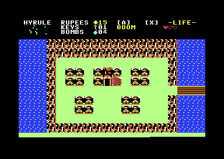
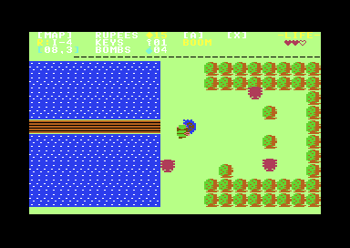

# The Legend of Zelda — Port C64

[](https://github.com/vedix95/ZELDAC64/releases)
[](https://github.com/vedix95/ZELDAC64/actions)
[](https://en.wikipedia.org/wiki/Commodore_64)
[](https://sourceforge.net/projects/acme-crossass/)
[](LICENSE)

Une récréation fidèle et authentique du chef-d'œuvre classique **The Legend of Zelda** (1986) pour l'ordinateur 8-bits **Commodore 64**, entièrement programmée en assembleur 6510 pour l'assembleur [ACME](https://sourceforge.net/projects/acme-crossass/) et testée avec l'émulateur [VICE](https://vice-emu.sourceforge.io/).

> *Ce projet est la création d'un passionné d'informatique rétro réalisée à l'aide de son IA préférée issue de chez Google.*

---

## 💾 Téléchargement Direct & Releases (v0.7)

L'image disquette officielle et prête à jouer est disponible au téléchargement sur la page des releases :

- 🎮 **[Télécharger l'image disquette v0.7 (`zelda.d64`)](https://github.com/vedix95/ZELDAC64/releases/latest)**
- ⚙️ **Distribution tout-en-un 1541** : La disquette `zelda.d64` rassemble l'introduction cinématique, le moteur résident avec musiques in-game authentiques (Overworld & Donjons) et le streaming dynamique des cartes et ennemis Overworld & 9 Donjons.
- 🚀 **Prêt à l'emploi** : La release ne propose que l'image disquette `.d64` standard, garantissant un démarrage direct et sans configuration.

Pour lancer directement la disquette dans [VICE](https://vice-emu.sourceforge.io/) :
```sh
x64sc -autostart zelda.d64
```

---

## Captures d'écran

### En jeu (Overworld, Donjons & Cimetière)

| Salle de départ & Grotte de l'Épée | Dans le Cimetière avec ennemis | Exploration Overworld (128 salles) |
| :---: | :---: | :---: |
|  |  |  |

| Entrée du Niveau 1 (L'Aigle) | Franchissement du pont de la rivière | Désert avec Peahats et Leevers |
| :---: | :---: | :---: |
|  |  |  |

### Cinématique d'Introduction Authentique (Chute d'eau, Parchemin & Bestiaire)

| Écran Titre & Cascade Animée | Déroulement de la Légende d'Hyrule | Présentation de tous les Trésors | Défilé des Monstres (Ghini) |
| :---: | :---: | :---: | :---: |
|  |  |  |  |

| Carte complète de l'Overworld (16×8 écrans — 128 salles) |
| :---: |
|  |

---

## Points forts & Fonctionnalités

- **Monde Overworld complet (128 salles — 16×8 écrans)** :
  - Fidélité complète à la disposition originale du jeu classique de 1986.
  - Transitions fluides d'écran à écran lors du franchissement des bordures.
- **Musiques in-game authentiques & Moteur Audio SID (Mono & Dual SID)** :
  - **Thème légendaire de l'Overworld** : 449 pas, polyphonie 3 voix complète (mélodie cuivrée pulse V1, contre-chant et harmonies sawtooth V2, basse bondissante triangle et caisse claire noise V3).
  - **Thème envoûtant des Donjons (Underworld)** : Partition extraite directement de la ROM originale NES (`zelda.nes` Banque 0).
  - **Rendu somptueux sur un seul SID standard** : Gestion fine des priorités SFX (bruits d'épée, tirs, bouclier, ennemis touchés/éliminés, rubis) garantissant la continuité du rythme.
  - **Support Dual SID ($D420 stéréo)** : Touche `3` en jeu pour basculer instantanément en mode stéréo (désaccord fin +2 Hz pour un effet chorus analogique sur les mélodies, et déport exclusif des effets sonores sur le 2e SID).
- **Les 9 Donjons complets d'Hyrule (Niveaux 1 à 9)** :
  - Intégration de l'ensemble des 9 donjons de la première quête : Niveau 1 (*L'Aigle*), Niveau 2 (*La Lune*), Niveau 3 (*Le Manji*), Niveau 4 (*Le Serpent*), Niveau 5 (*Le Lézard*), Niveau 6 (*Le Dragon*), Niveau 7 (*Le Démon*), Niveau 8 (*Le Lion*) et Niveau 9 (*La Montagne de la Mort*).
  - Entrées de donjon authentiques réparties sur la carte Overworld (arbres, grottes, passages secrets) et portes de sortie au sud de chaque niveau.
  - Palettes de couleurs authentiques pour chaque donjon (Cyan, Bleu, Vert, Gris clair, Rouge, Orange/Marron, Vert forêt, Bleu ciel, Rouge cramoisi).
  - Bestiaire et monstres souterrains complets : Stalfos, Goriyas, Keeses, slimes Gel/Zol, Wallmasters, pièges Trap et boss Aquamentus.
  - Streaming dynamique des ennemis depuis la disquette 1541 en `$B800` pour préserver la mémoire vive résidente sous les 64 Ko.
- **Cinématique d'introduction complète** :
  - Chute d'eau animée avec défilement vertical matériel du VIC-II.
  - Défilement du parchemin contant la légende d'Hyrule, présentation des trésors et logo Zelda.
  - Musique d'intro complète et fidèle reproduite sur le processeur audio **SID 6581/8580** (3 voix).
- **Moteur de sprites & multiplexage dynamique** :
  - Multiplexeur de sprites géré par interruption raster IRQ permettant d'afficher jusqu'à 8 ennemis ou projectiles simultanément à l'écran.
  - Sprites multicolores pour Link, les ennemis, les objets et les PNJ.
- **Système de combat & arsenal complet** :
  - **Épée** : Attaque au corps-à-corps avec rayon d'épée projeté lorsque la vie est pleine.
  - **Boomerang** : Animation de rotation avec trajectoire de vol et retour vers Link.
  - **Bombes** : Déflagration 3×3 destructrice de blocs et d'ennemis.
  - **Arc & Flèches** : Tirs à distance avec décompte de rubis.
  - **Bougie bleue** : Émission de flammes illuminant et attaquant.
- **Intelligence artificielle des ennemis & butin** :
  - Octoroks (rouges et bleus), Moblins, Tektites, Keeses, Leevers, Peahats volants du désert et Zoras fluviaux avec tirs de boules de feu traversantes.
  - Animation de mort authentique avec nuage de fumée et dissipation progressive.
  - Disparition propre des monstres lors des transitions d'écran en défilement.
- **Passages secrets & Murs explosables à la bombe** :
  - Détection des déflagrations de bombes sur les murs fissurés, ouverture persistante des entrées de cavernes cachées et carillon de secret SID 8 notes.
- **Réseau hydrographique & Ponts franchissables** :
  - Ponts horizontaux et verticaux praticables permettant d'accéder au Niveau 1 (L'Aigle) et aux différentes îles de l'Overworld.
- **Grottes secrètes & PNJ** :
  - Le vieil homme (*« IT'S DANGEROUS TO GO ALONE ! TAKE THIS. »*), torches animées et ramassage d'épée.
- **HUD & Inventaire graphique complet** :
  - Affichage tête haute en temps réel (cœurs de vie, mini-carte dynamique, compteurs de rubis, clés et bombes, armes actives A et B).
  - Écran d'inventaire interactif accessible avec la touche `B`.
- **Architecture disquette D64 à chargement dynamique** :
  - Image disquette 1541 standard (`zelda.d64`) contenant l'intro, le moteur de jeu résident et les cartes chargées à la demande via les routines KERNAL IEC en `$A000`.
- **Éditeur de niveau visuel intégré** (`tools/editor.py`) :
  - Interface web interactive en Python permettant d'éditer la carte, les salles, les ennemis et les objets avec recompilation à la volée.

---

## Prérequis

Sur les distributions basées sur Arch Linux :
```sh
sudo pacman -S acme vice python python-pillow
```

Sur Debian / Ubuntu :
```sh
sudo apt-get update
sudo apt-get install -y acme vice python3 python3-pil
```

Vérifier la configuration de votre environnement de développement :
```sh
make check
```

---

## Compilation et Lancement

| Commande | Action |
| :--- | :--- |
| `make` | Compile le projet complet et génère l'image disquette `build/zelda.d64` |
| `make run` | Lance la disquette complète dans VICE (Intro cinéma + enchaînement sur le jeu) |
| `make run-game` | Lance directement le moteur de jeu résident sans passer par l'intro |
| `make debug` | Lance dans VICE avec chargement automatique des labels symboliques (`build/zelda.vs`) |
| `make editor` | Lance l'éditeur de niveau visuel interactif |
| `make preview` | Génère les aperçus graphiques PNG des sprites et du monde dans `build/` |
| `make clean` | Nettoie les fichiers de build temporaires (`build/`) |
| `make distclean` | Nettoie les fichiers de build et les fichiers ASM générés |

---

## Contrôles

### En jeu (Joystick Port 2 ou Clavier)

Le jeu se joue idéalement avec une manette ou un joystick branché sur le **Port 2**. Dans VICE, configurez le joystick dans `Settings > Input devices > Joystick > Joystick #2` (clavier ou manette USB).

| Touche / Action | Rôle |
| :--- | :--- |
| **Joystick Direction** / Pavé numérique | Déplacements de Link (Haut, Bas, Gauche, Droite) |
| **Bouton Feu** / `X` | Coup d'épée (et tir d'épée si PV au maximum) |
| `A` | Utiliser l'arme secondaire active (Boomerang, Bombe, Arc, Bougie) |
| `B` | Ouvrir / Fermer le menu d'inventaire |
| `D` | Ouvrir / Fermer le moniteur de debug (mémoire, registres VIC-II / SID) |
| `3` | Basculer mode Dual SID ($D420 stéréo) / Mono SID ($D400) |
| `Espace` / `Entrée` | Valider / Passer l'écran d'introduction |

---

## Architecture de la Disquette C64 (`zelda.d64`)

La disquette 1541 est formatée sous le nom `zelda,01` et contient 4 fichiers principaux :

1. `INTRO` (`PRG`) : Programme d'introduction autonome exécuté au démarrage (`$0801`–`$3FFF`), gérant la cascade, le parchemin en défilement vertical fin et la musique SID complète.
2. `ZELDA` (`PRG`) : Moteur de jeu principal résident en mémoire (`$0801`–`$9F55`), incluant le pilote audio SID Overworld & Underworld.
3. `MAP_OW` (`DAT`) : Données binaires de la carte de l'Overworld (128 salles), chargées dynamiquement à l'adresse `$A000` via le bus série IEC KERNAL.
4. `MAP_UW` (`DAT`) : Données binaires des 9 donjons de l'Underworld, chargées dynamiquement à `$A000`.

### Carte mémoire du C64

```
+------------------+ $FFFF
| Vecteurs KERNAL  |
+------------------+ $E000
| ROM KERNAL / I/O | $D000 - $DFFF : Registres VIC-II, SID 1 ($D400), SID 2 ($D420), CIA 1/2, Color RAM
+------------------+ $D000
| Zone dynamique   | $A000 - $CFFF : Carte active chargée depuis D64 (MAP_OW / MAP_UW)
+------------------+ $A000
| Moteur de jeu    | $0801 - $9FFF : Code assembleur, tables d'IA, multiplexeur, HUD, moteur audio SID
+------------------+ $2000 - $27FF : Jeu de caractères multicolore des tuiles (Charset)
| Mémoire écran    | $0400 - $07E7 : Matrice d'écran vidéo VIC-II ($07F8-$07FF : Pointers sprites)
+------------------+ $0400
| Zone système     | $0200 - $03FF : Vecteurs KERNAL/BASIC, buffers I/O disquette
| Pile processeur  | $0100 - $01FF : Pile matérielle 6502
| Page Zéro ($00)  | $0002 - $00FF : Pointeurs rapides, état du joueur, registres virtuels
+------------------+ $0000
```

---

## Arborescence du Projet

```
.
├── assets/                     # Fichiers sources d'assets (ASCII art, textes, MIDI)
│   ├── link.txt                # Sprites multicolores de Link (4 directions + attaque)
│   ├── enemies.txt             # Sprites multicolores des ennemis et boss
│   ├── extra.txt               # Sprites du Vieil Homme, objets et effets
│   ├── tiles.txt               # Définition des tuiles 16x16 et palettes multicolores
│   ├── world.txt               # Carte Overworld complète (16x8 écrans, 128 salles)
│   ├── underworld.txt          # Carte des donjons Underworld (Level 1)
│   └── *.mid                   # Fichiers MIDI sources transcrits pour le SID
├── docs/                       # Documentation et médias
│   └── images/                 # Captures d'écran et aperçus pour GitHub
├── scripts/                    # Scripts utilitaires shell (vérification d'environnement)
│   └── check-env.sh            # Vérification des dépendances logicielles
├── src/                        # Code source assembleur 6510 (ACME)
│   ├── main.asm                # Point d'entrée, stub BASIC, boucle principale et IRQ
│   ├── sound.asm               # Moteur audio SID (Mono et Dual SID $D420, Overworld & Donjon, SFX)
│   ├── music_data.inc          # [GÉNÉRÉ] Partitions et notes Overworld et Donjon
│   ├── c64.inc                 # Définitions matérielles (VIC-II, SID, CIA, Page Zéro)
│   ├── player.asm              # Déplacements, animations et boîte de collision de Link
│   ├── enemies.asm             # IA des ennemis, tables de comportement, attaques et butin
│   ├── items.asm               # Gestion des armes secondaires, projectiles et ramassage
│   ├── inventory.asm           # Logique du menu d'inventaire
│   ├── inventory_draw.asm      # Rendu graphique en 4 pages du menu d'inventaire
│   ├── hud.asm                 # Rendu dynamique du HUD (cœurs, mini-carte, compteurs, niveau)
│   ├── cave.asm                # Système des grottes secrètes et entrées des 9 donjons
│   ├── tilemap.asm             # Moteur de rendu des tuiles, palettes et transitions
│   ├── sprites.asm             # [GÉNÉRÉ] Données binaires des sprites de Link
│   ├── sprites_enemies.asm     # [GÉNÉRÉ] Données binaires des sprites d'ennemis
│   ├── sprites_extra.asm       # [GÉNÉRÉ] Données binaires des sprites spéciaux et PNJ
│   ├── charset.asm             # [GÉNÉRÉ] Jeu de caractères multicolores VIC-II
│   ├── tiles_data.asm          # [GÉNÉRÉ] Tables de correspondance et attributs des tuiles
│   ├── map_overworld.asm       # [GÉNÉRÉ] Données compilables de la carte Overworld
│   ├── map_underworld.asm      # [GÉNÉRÉ] Données compilables de l'Underworld (9 donjons)
│   ├── disk.asm                # Routines KERNAL IEC de streaming disquette 1541
│   ├── intro.asm               # Logique de la cinématique d'introduction
│   ├── intro_main.asm          # Point d'entrée de l'exécutable autonome d'intro
│   ├── intro_music_data.asm    # Partitions et commandes pour le pilote sonore de l'intro
│   ├── input.asm               # Lecture sécurisée du joystick port 2 et du clavier
│   ├── transition.asm          # Gestion des transitions d'écran à écran
│   └── debug.asm               # Moniteur de debug mémoire et registres matériels
├── tools/                      # Outils Python de conversion, extraction et édition
│   ├── editor.py               # Éditeur visuel interactif web de niveaux et d'ennemis
│   ├── generate_game_audio.py  # Extraction et encodage compact des musiques pour SID
│   ├── convert_nes_underworld.py # Extraction des 9 donjons depuis la ROM NES
│   ├── sprgen.py               # Générateur de sprites C64 depuis l'ASCII art
│   ├── tilegen.py              # Compilateur de tuiles et cartes du monde
│   ├── midi_to_sid.py          # Convertisseur MIDI vers code assembleur SID
│   └── generate_*.py           # Générateurs spécialisés de données et tables
├── Makefile                    # Système de compilation et d'automatisation
├── LICENSE                     # Licence MIT et clause d'avertissement légal
└── README.md                   # Ce fichier
```

---

## Mentions Légales & Droits d'Auteur

*The Legend of Zelda*, ainsi que les personnages, logos, musiques et graphismes associés sont des marques déposées et propriétés exclusives de **Nintendo Co., Ltd.**

Ce projet est un travail d'hommage bénévole, non-commercial et éducatif : la création d'un passionné d'informatique rétro réalisée à l'aide de son IA préférée issue de chez Google afin d'explorer et de célébrer les capacités matérielles du Commodore 64. Il n'est en aucune manière affilié à, autorisé ou approuvé par Nintendo.
