# The Legend of Zelda — Port C64

[](https://github.com/vedix95/ZELDAC64/releases)
[](https://github.com/vedix95/ZELDAC64/actions)
[](https://en.wikipedia.org/wiki/Commodore_64)
[](https://sourceforge.net/projects/acme-crossass/)
[](LICENSE)

Une récréation fidèle et authentique du chef-d'œuvre classique **The Legend of Zelda** (1986) pour l'ordinateur 8-bits **Commodore 64**, entièrement programmée en assembleur 6510 pour l'assembleur [ACME](https://sourceforge.net/projects/acme-crossass/) et testée avec l'émulateur [VICE](https://vice-emu.sourceforge.io/).

> *Ce projet est la création d'un passionné d'informatique rétro réalisée à l'aide de son IA préférée issue de chez Google.*

---

## 💾 Téléchargement Direct & Releases (v0.8.1)

L'image disquette officielle et prête à jouer est disponible au téléchargement sur la page des releases :

- 🎮 **[Télécharger l'image disquette v0.8.1 (`zelda.d64`)](https://github.com/vedix95/ZELDAC64/releases/latest)**
- ⚙️ **Distribution tout-en-un 1541** : La disquette `zelda.d64` rassemble l'introduction cinématique, le moteur résident avec musiques in-game 100% authentiques NES (Overworld & Donjons), le bestiaire complet extrait fidèlement de la ROM `zelda.nes`, et les 9 Donjons autonomes (`DUNG1.DAT` à `DUNG9.DAT`) chargés à la volée.
- 🚀 **Prêt à l'emploi** : La release ne propose que l'image disquette `.d64` standard, garantissant un démarrage direct et sans configuration.

Pour lancer directement la disquette dans [VICE](https://vice-emu.sourceforge.io/) :
```sh
x64sc -autostart zelda.d64
```

---

## Captures d'écran

### En jeu (Overworld, Donjons, Monstres & Boss)

| Overworld & Radar GPS | Entrée du Donjon 1 (L'Aigle) |
| :---: | :---: |
| 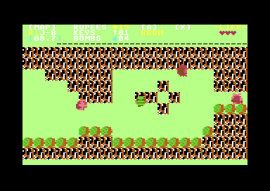 | 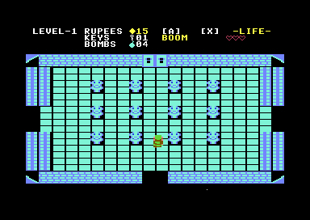 |

| Combat contre le Boss Aquamentus | Salle des Monstres Stalfos (Donjon 1) |
| :---: | :---: |
| 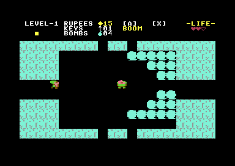 | 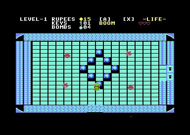 |

| Salle de départ & Grotte de l'Épée | Cimetière avec Ghinis | Désert avec Peahats |
| :---: | :---: | :---: |
| 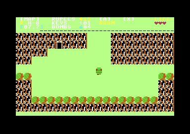 | 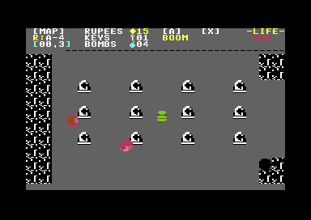 | 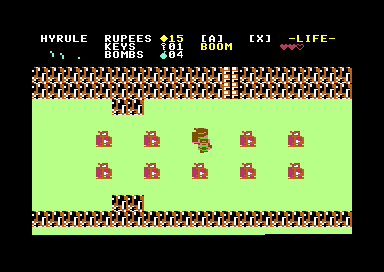 |

### Cinématique d'Introduction Authentique (Chute d'eau, Parchemin & Bestiaire)

| Écran Titre & Cascade Animée | Déroulement de la Légende d'Hyrule | Présentation de tous les Trésors | Défilé des Monstres (Ghini) |
| :---: | :---: | :---: | :---: |
| 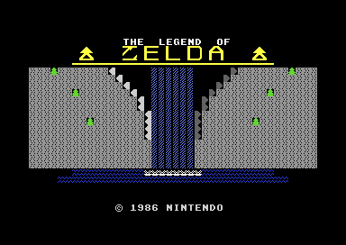 | 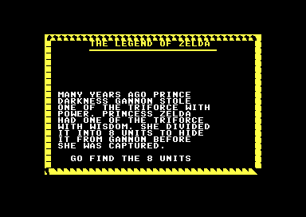 | 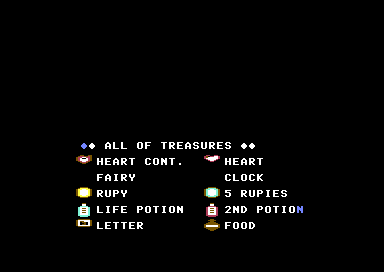 | 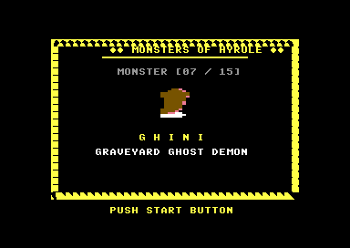 |

| Carte complète de l'Overworld (16×8 écrans — 128 salles) |
| :---: |
|  |

---

## 🎵 Bande-Sonore SID & Extraits Audio MP3

Les musiques du jeu ont été fidèlement retranscrites et synthétisées directement sur la puce sonore analogique **MOS SID 6581/8580** du Commodore 64 à partir des partitions originales NES. Enregistrement direct sous émulation cycle-accurate reSID (48 kHz, 192 kbps) :

| Piste & Scène | Description | Écoute directe | Fichier MP3 |
| :--- | :--- | :---: | :---: |
| 🛡️ **Thème Overworld (Aventure)** | La boucle légendaire d'exploration d'Hyrule, avec sa ligne de basse profonde Voice 3 calibrée à l'octave exacte sans suraigus. | <audio controls src="docs/audio/zelda_overworld.mp3"></audio> | [zelda_overworld.mp3](docs/audio/zelda_overworld.mp3) |
| 🗝️ **Thème des Donjons (Underworld)** | L'atmosphère mystérieuse des Labyrinthes 1 à 8, avec ses arpèges G-mineur entrelacés en onde Pulse 50% sur 2 voix et basse sourde. | <audio controls src="docs/audio/zelda_dungeon.mp3"></audio> | [zelda_dungeon.mp3](docs/audio/zelda_dungeon.mp3) |
| 📜 **Thème d'Introduction & Titre** | La partition épique de l'écran-titre avec cascade et du défilement de la Légende d'Hyrule. | <audio controls src="docs/audio/zelda_intro.mp3"></audio> | [zelda_intro.mp3](docs/audio/zelda_intro.mp3) |

---

## Points forts & Fonctionnalités

- **Monde Overworld complet (128 salles — 16×8 écrans)** :
  - Fidélité complète à la disposition originale du jeu classique de 1986.
  - Transitions fluides d'écran à écran lors du franchissement des bordures.
- **Musiques in-game 100% authentiques NES & Moteur Audio SID** :
  - **Thème légendaire d'exploration Overworld** : Boucle d'aventure authentique (sans confusion avec l'intro), basse profonde Voice 3 calibrée sur l'octave exacte du processeur Triangle NES, éliminant tout sifflement aigu.
  - **Thème envoûtant des Donjons (Underworld)** : Partition pure des Niveaux 1 à 8 extraite de la cartouche NES (`zelda.nes` Banque 0), arpège G-mineur envoûtant en onde Pulse 50% sur 2 voix entrelacées et basse continue.
  - **Rendu somptueux sur un seul SID standard** : Gestion fine des priorités SFX (bruits d'épée, tirs, bouclier, ennemis touchés/éliminés, rubis) garantissant la continuité du rythme.
  - **Support Dual SID ($D420 stéréo)** : Touche `3` en jeu pour basculer instantanément en mode stéréo (désaccord fin +2 Hz pour un effet chorus analogique sur les mélodies, et déport exclusif des effets sonores sur le 2e SID).
- **Les 9 Donjons complets d'Hyrule en fichiers autonomes (`DUNG1.DAT` à `DUNG9.DAT`)** :
  - **Architecture Multi-Fichiers 1541** : Remplacement de l'ancien bloc monolithique par 9 overlays de donjons distincts (`DUNG1.DAT` à `DUNG9.DAT`), compilés séparément et chargés dynamiquement à la volée en `$A000` via KERNAL IEC lors de l'entrée dans un donjon ou du changement de niveau.
  - **Optimisation drastique de la RAM** : L'Overworld et les donjons ne se partagent plus la même mémoire vive résidente. Chaque fichier donjon embarque ses propres salles, portes, clés, objets, décors et tables d'apparition de monstres et de boss.
  - **Mécanique des portes 1:1 NES** : Portes ouvertes, portes verrouillées nécessitant une clé `🗝`, portes à volets métalliques s'ouvrant après élimination des ennemis ou du boss de fin de donjon.
  - Palettes de couleurs authentiques pour chaque donjon (Cyan, Bleu, Vert, Gris clair, Rouge, Orange/Marron, Vert forêt, Bleu ciel, Rouge cramoisi).
- **Bestiaire et Boss 100% fidèles extraits de la ROM `zelda.nes`** :
  - **Élimination complète des sprites approximatifs et du bug de dilatation** : Les graphismes proviennent directement des banques CHR de la cartouche NES (`zelda.nes`).
  - **Squelettes Stalfos** : Crâne avec orbites noires creuses, cage thoracique avec côtes et vertèbres visibles, marche fluide avec doubles épées.
  - **Chauve-souris Keese** : Ailes déployées à découpe dentelée et yeux incandescents (frame 0), ailes repliées vers le bas (frame 1).
  - **Diablotins Goriya** : Oreilles pointues, museau de diablotin, posture de face et de profil brandissant le boomerang.
  - **Boss géants plein format (12×21 double-pixels C64)** :
    - **Aquamentus** : Dragon vert cornu à gueule béante garnie de crocs, ailes écailleuses, serres et crachat de triples boules de feu rotatives.
    - **Dodongo** : Dinosaure cuirassé quadrupède avec écailles dorsales et queue articulée.
    - **Gohma** : Araignée colossale avec œil unique fermé et grand œil ouvert avec iris et pupille.
    - **Ganon** : Démon-sanglier géant avec crâne menaçant, défenses et trident.
  - **Bestiaire souterrain & Overworld complet (83 sprites)** : Darknut, Pols Voice (grandes oreilles de lapin et moustaches), Gibdo (momie en bandelettes), Like Like (tube ondulé mangeur de bouclier), Vire, Wizzrobe (robe et capuche de sorcier), Wallmaster (main rampante à 5 doigts), Octoroks, Moblins, Tektites, Leevers, Peahats, Armos, Ghinis, Zoras et Lynels.
- **HUD sur fond noir & Mini-carte 1:1** :
  - **HUD sur fond noir complet** : Alignement parfait sans trait résiduel sous la barre d'état.
  - **Mini-carte matricielle 1 pixel par salle** : En Overworld (radar GPS vert clair) et en Donjon (mini-carte blanche avec coloration cyan des salles explorées et position de Link en jaune vif).
- **Moteur Audio SID & Restitution des Voix** :
  - Correction de la reprise du canal musical : à chaque utilisation d'arme (coup d'épée, boomerang, bombe), le canal sonore SID est immédiatement et proprement restitué à la musique d'ambiance sans interruption ni perte de note.
- **Éditeur de niveau visuel intégré** (`tools/editor.py`) :
  - Interface web interactive en Python permettant d'éditer la carte, les salles, les ennemis et les objets avec recompilation à la volée.

---

## Prérequis

Sur les distributions basées sur Arch Linux :
```sh
sudo pacman -S acme vice python python-pillow
```

Sur Debian / Ubuntu :
```sh
sudo apt-get update
sudo apt-get install -y acme vice python3 python3-pil
```

Vérifier la configuration de votre environnement de développement :
```sh
make check
```

---

## Compilation et Lancement

| Commande | Action |
| :--- | :--- |
| `make` | Compile le projet complet et génère l'image disquette `build/zelda.d64` |
| `make run` | Lance la disquette complète dans VICE (Intro cinéma + enchaînement sur le jeu) |
| `make run-game` | Lance directement le moteur de jeu résident sans passer par l'intro |
| `make debug` | Lance dans VICE avec chargement automatique des labels symboliques (`build/zelda.vs`) |
| `make editor` | Lance l'éditeur de niveau visuel interactif |
| `make preview` | Génère les aperçus graphiques PNG des sprites et du monde dans `build/` |
| `make clean` | Nettoie les fichiers de build temporaires (`build/`) |
| `make distclean` | Nettoie les fichiers de build et les fichiers ASM générés |

---

## Contrôles

### En jeu (Joystick Port 2 ou Clavier)

Le jeu se joue idéalement avec une manette ou un joystick branché sur le **Port 2**. Dans VICE, configurez le joystick dans `Settings > Input devices > Joystick > Joystick #2` (clavier ou manette USB).

| Touche / Action | Rôle |
| :--- | :--- |
| **Joystick Direction** / Pavé numérique | Déplacements de Link (Haut, Bas, Gauche, Droite) |
| **Bouton Feu** / `X` | Coup d'épée (et tir d'épée si PV au maximum) |
| `A` | Utiliser l'arme secondaire active (Boomerang, Bombe, Arc, Bougie) |
| `B` | Ouvrir / Fermer le menu d'inventaire |
| `D` | Ouvrir / Fermer le moniteur de debug (mémoire, registres VIC-II / SID) |
| `3` | Basculer mode Dual SID ($D420 stéréo) / Mono SID ($D400) |
| `Espace` / `Entrée` | Valider / Passer l'écran d'introduction |

---

## Architecture de la Disquette C64 (`zelda.d64`)

La disquette 1541 est formatée sous le nom `zelda,01` et contient les fichiers suivants :

1. `INTRO` (`PRG`) : Programme d'introduction autonome exécuté au démarrage (`$0801`–`$3FFF`), gérant la cascade, le parchemin en défilement vertical fin et la musique SID complète.
2. `ZELDA` (`PRG`) : Moteur de jeu principal résident en mémoire (`$0801`–`$9F55`), incluant le pilote audio SID Overworld & Underworld et les 83 sprites d'ennemis originaux en `$2800`–`$3FFF`.
3. `MAP_OW` (`DAT`) : Données binaires de la carte de l'Overworld (128 salles), chargées dynamiquement à l'adresse `$A000` via le bus série IEC KERNAL.
4. `DUNG1` à `DUNG9` (`DAT`) : Fichiers autonomes de chacun des 9 donjons d'Hyrule (salles, portes, clés, objets, décors et tables d'ennemis/boss), chargés dynamiquement à `$A000`.

### Carte mémoire du C64

```
+------------------+ $FFFF
| Vecteurs KERNAL  |
+------------------+ $E000
| ROM KERNAL / I/O | $D000 - $DFFF : Registres VIC-II, SID 1 ($D400), SID 2 ($D420), CIA 1/2, Color RAM
+------------------+ $D000
| Zone dynamique   | $A000 - $CFFF : Carte active chargée depuis D64 (MAP_OW / MAP_UW)
+------------------+ $A000
| Moteur de jeu    | $0801 - $9FFF : Code assembleur, tables d'IA, multiplexeur, HUD, moteur audio SID
+------------------+ $2000 - $27FF : Jeu de caractères multicolore des tuiles (Charset)
| Mémoire écran    | $0400 - $07E7 : Matrice d'écran vidéo VIC-II ($07F8-$07FF : Pointers sprites)
+------------------+ $0400
| Zone système     | $0200 - $03FF : Vecteurs KERNAL/BASIC, buffers I/O disquette
| Pile processeur  | $0100 - $01FF : Pile matérielle 6502
| Page Zéro ($00)  | $0002 - $00FF : Pointeurs rapides, état du joueur, registres virtuels
+------------------+ $0000
```

---

## Arborescence du Projet

```
.
├── assets/                     # Fichiers sources d'assets (ASCII art, textes, MIDI)
│   ├── link.txt                # Sprites multicolores de Link (4 directions + attaque)
│   ├── enemies.txt             # Sprites multicolores des ennemis et boss
│   ├── extra.txt               # Sprites du Vieil Homme, objets et effets
│   ├── tiles.txt               # Définition des tuiles 16x16 et palettes multicolores
│   ├── world.txt               # Carte Overworld complète (16x8 écrans, 128 salles)
│   ├── underworld.txt          # Carte des donjons Underworld (Level 1)
│   └── *.mid                   # Fichiers MIDI sources transcrits pour le SID
├── docs/                       # Documentation et médias
│   ├── audio/                  # Enregistrements audio SID authentiques (MP3 192k)
│   └── images/                 # Captures d'écran et aperçus pour GitHub
├── LegendOfZeldaNESRecomp/     # Référence complète du décompilateur Zelda NES
├── scripts/                    # Scripts utilitaires shell (vérification d'environnement)
│   └── check-env.sh            # Vérification des dépendances logicielles
├── src/                        # Code source assembleur 6510 (ACME)
│   ├── main.asm                # Point d'entrée, stub BASIC, boucle principale et IRQ
│   ├── sound.asm               # Moteur audio SID (Mono et Dual SID $D420, Overworld & Donjon, SFX)
│   ├── music_data.inc          # [GÉNÉRÉ] Partitions et notes Overworld et Donjon
│   ├── c64.inc                 # Définitions matérielles (VIC-II, SID, CIA, Page Zéro)
│   ├── player.asm              # Déplacements, animations et boîte de collision de Link
│   ├── enemies.asm             # IA des ennemis, tables de comportement, attaques et butin
│   ├── items.asm               # Gestion des armes secondaires, projectiles et ramassage
│   ├── inventory.asm           # Logique du menu d'inventaire
│   ├── inventory_draw.asm      # Rendu graphique en 4 pages du menu d'inventaire
│   ├── hud.asm                 # Rendu dynamique du HUD (cœurs, mini-carte, compteurs, niveau)
│   ├── cave.asm                # Système des grottes secrètes et entrées des 9 donjons
│   ├── tilemap.asm             # Moteur de rendu des tuiles, palettes et transitions
│   ├── sprites.asm             # [GÉNÉRÉ] Données binaires des sprites de Link
│   ├── sprites_enemies.asm     # [GÉNÉRÉ] Données binaires des sprites d'ennemis
│   ├── sprites_extra.asm       # [GÉNÉRÉ] Données binaires des sprites spéciaux et PNJ
│   ├── charset.asm             # [GÉNÉRÉ] Jeu de caractères multicolores VIC-II
│   ├── tiles_data.asm          # [GÉNÉRÉ] Tables de correspondance et attributs des tuiles
│   ├── map_overworld.asm       # [GÉNÉRÉ] Données compilables de la carte Overworld
│   ├── dungeon.asm             # Moteur de règles des donjons (portes, clés, volets, secrets)
│   ├── dung1.asm ... dung9.asm # [GÉNÉRÉ] Fichiers assembleur autonomes des 9 Donjons d'Hyrule
│   ├── disk.asm                # Routines KERNAL IEC de streaming disquette 1541
│   ├── intro.asm               # Logique de la cinématique d'introduction
│   ├── intro_main.asm          # Point d'entrée de l'exécutable autonome d'intro
│   ├── intro_music_data.asm    # Partitions et commandes pour le pilote sonore de l'intro
│   ├── input.asm               # Lecture sécurisée du joystick port 2 et du clavier
│   ├── transition.asm          # Gestion des transitions d'écran à écran
│   └── debug.asm               # Moniteur de debug mémoire et registres matériels
├── tools/                      # Outils Python de conversion, extraction et édition
│   ├── editor.py               # Éditeur visuel interactif web de niveaux et d'ennemis
│   ├── generate_game_audio.py  # Extraction et encodage compact des musiques pour SID
│   ├── convert_nes_underworld.py # Extraction des 9 donjons depuis la ROM NES
│   ├── sprgen.py               # Générateur de sprites C64 depuis l'ASCII art
│   ├── tilegen.py              # Compilateur de tuiles et cartes du monde
│   ├── midi_to_sid.py          # Convertisseur MIDI vers code assembleur SID
│   └── generate_*.py           # Générateurs spécialisés de données et tables
├── Makefile                    # Système de compilation et d'automatisation
├── LICENSE                     # Licence MIT et clause d'avertissement légal
└── README.md                   # Ce fichier
```

---

## Mentions Légales & Droits d'Auteur

*The Legend of Zelda*, ainsi que les personnages, logos, musiques et graphismes associés sont des marques déposées et propriétés exclusives de **Nintendo Co., Ltd.**

Ce projet est un travail d'hommage bénévole, non-commercial et éducatif : la création d'un passionné d'informatique rétro réalisée à l'aide de son IA préférée issue de chez Google afin d'explorer et de célébrer les capacités matérielles du Commodore 64. Il n'est en aucune manière affilié à, autorisé ou approuvé par Nintendo.
