# The Legend of Zelda — Port Commodore 64

[](https://github.com/vedix95/ZELDAC64/releases)
[](https://github.com/vedix95/ZELDAC64/actions)
[](https://en.wikipedia.org/wiki/Commodore_64)
[](https://sourceforge.net/projects/acme-crossass/)
[](docs/audio/)
[](DOCUMENTATION.md)
[](LICENSE)

Une recréation fidèle, intégrale et fluide à **50,00 FPS constants (PAL)** du classique **The Legend of Zelda** (1986) sur **Commodore 64**, programmée en assembleur pur MOS 6510 pour le cross-assembleur [ACME](https://sourceforge.net/projects/acme-crossass/) et optimisée pour l'émulateur [VICE](https://vice-emu.sourceforge.io/) ainsi que le matériel réel.

> *Ce projet est la création d'un passionné d'informatique rétro réalisée à l'aide de son IA préférée issue de chez Google.*

---

## 🌟 La Vitrine du Jeu : Points Forts

* 🏰 **L'intégralité d'Hyrule sur C64 (Fidélité 1:1 NES)** :
  * **128 salles d'Overworld** reproduites tuile par tuile depuis `zelda.nes` avec la **Forêt Enchantée / Perdue authentique (`B-7`)**, les **Collines Perdues (`L-2`)**, les **7 rochers poussables au Bracelet de Force** et **2 tombes poussables** (glissement 1 case avec effort + tremblement identique aux donjons), les 5 secrets Armos, 12 arbres brûlables, grottes d'ermites, fontaines des fées et boutiques.
  * **Les 9 Donjons complets** (Niveaux 1 à 9, 189 salles actives) avec leurs labyrinthes, portes à clés, blocs secrets poussables, celliers souterrains, **Goriya Affamé en D7 (`"GRUMBLE, GRUMBLE..."`)**, porte scellée des 8 fragments de Triforce en D9, affrontement final contre **Ganon** et **sauvetage de la Princesse Zelda** (`STATE_ENDING`), ainsi qu'un cycle complet **Game Over / Continue**.
  * **Tous les Boss originaux** : Aquamentus, Dodongo (orange authentique), Manhandla, Gleeok (D4 & D8), Digdogger, Gohma et Ganon.
* 📜 **Introduction & Prologue Cinématique 1:1 NES** :
  * **Écran Titre & Cascade Animée** : Palette de l'aube, lettres ZELDA cramoisies bordées d'or, étoile scintillante Sprite 0 et vagues descendantes Sprites 1..4.
  * **Récit d'Hyrule en Scrolling Matériel 50 Hz** : Défilement vertical au pixel près via `$D011` dans son cadre de pierre centré (`RSEL=0`).
  * **Défilé des 35 Trésors & Bestiaire Multimonstres** : Présentation sur 2 colonnes et moteur à 6 slots simultanés animés.
* ⚡ **Cartouche EasyFlash 1 Mo (`zelda.crt` ID 32) & Sauvegarde Flash Native** :
  * Déballage du moteur en 0,2 seconde au démarrage, zéro latence disquette.
  * **Sauvegarde native sur Flash `Am29F040` (Secteur 7, Banques 56..63)** avec menu **File Select 1:1 NES** (`- SELECT -`, `REGISTER YOUR NAME`, `ELIMINATION MODE`, `RESET ALL SAVES`), sprites de Link animés selon la tunique, stats `SWD`/`SHD`/`D`/`T` et cœurs `♥` rouges.
  * **Cache d'overlay résident (`loaded_overlay_bank`)** et streaming page par page sécurisé (`CLI` + garde `irq_top`) : **19 656 cycles/trame PAL exacts (50,00 FPS)** même avec 6 à 8 ennemis simultanés, explosions 2×2 et poussées continues.
* 🗡️ **Système de Combat, Tuniques, Drops & Arsenal Complet des 8 Objets** :
  * Épée (Bois / Blanche / Magique + **jeté d'épée laser à vie pleine**), **Bombes à explosion 2×2 (48×42 px, rayon 32 px)**, Boomerang, Arc/Flèches (Bois & Argent pour Ganon), Bougie (Bleue 1/salle & Rouge illimitée, éclaire les **salles sombres**), Flûte magique (téléportation + lac D7 + Digdogger), Viande/Appât, Potion et Baguette Magique (vague + **flamme du Livre Magique**).
  * **Tuniques & Dégâts calibrés en quarts de cœur** (Verte `1x`, Anneau Bleu `÷2`, Anneau Rouge `÷4` alterné), **drops physiques au sol** (Rubis `+1`/`+5`, Bombes `+4`, Cœurs, **Fées autonomes**, Horloge) à taux équilibrés NES.
  * Échelle de franchissement autonome (Sprite 2, zéro mutation de `room_buf`) et radeau de traversée fluviale.
* 👑 **HUD Authentique & Inventaire 4 Pages Haute Résolution** :
  * HUD complet : compteurs **Rubis 3 chiffres (`000..255`)**, Clés, Bombes, **cadres bleus `[A]` et `[X]` avec icônes d'objets et d'épée**, et jusqu'à 16 cœurs divisés en **quarts de cœur (`1/4..4/4`)** (plafond strict et persistance Flash).
  * **Page 0** : Grille d'objets 4×2 (masquage strict des objets non possédés) + 6 reliques passives protégées.
  * **Page 1** : **Grande Pyramide de la Triforce** (8 fragments biseautés en triangle doré plein 96×42 px).
  * **Page 2 & Page 3** : Statut de quête et **Carte topologique d'Hyrule 16×8** + plan dynamique des donjons avec boussole.
* 🎶 **Moteur Audio SID & Dual SID Stéréo (`$D420` / `$D500` / `$DF00`)** :
  * Synthèse analogique 3 voix **MOS SID 6581/8580** + chorus stéréo Dual SID commutable en jeu (touche `3`).
  * Thème authentique étendu du **Donjon 9 (Death Mountain, 124 pas)** streamé depuis la Banque 31, **animation & jingle de mort de Link**, thème **Game Over NES (`$92F7`)**, alerte vie basse, refonte de `SFX_LINK_HURT` et file d'attente sonore anti-conflits.

---

## 📸 Le Jeu en Action (Captures Live `build/zelda.crt`)

### Introduction & Cinématiques 1:1 NES

| Écran Titre & Cascade | Récit d'Hyrule (Cadre Pierre) | Défilé des 35 Trésors | File Select & Sauvegarde Flash |
| :---: | :---: | :---: | :---: |
| 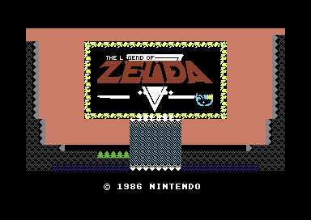 | 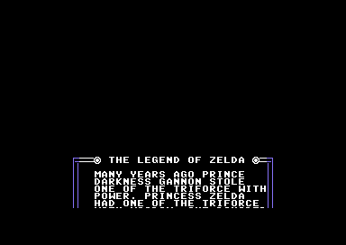 | 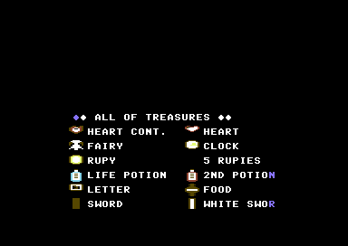 | 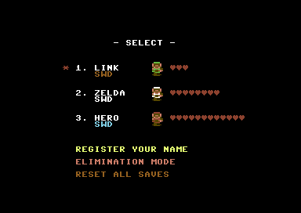 |

### Exploration, Secrets Overworld & Combat

| Départ d'Hyrule (`H-8`) | Forêt Enchantée (`B-7`) | Rocher Poussé (`J-8`, glissement 1 case) |
| :---: | :---: | :---: |
| 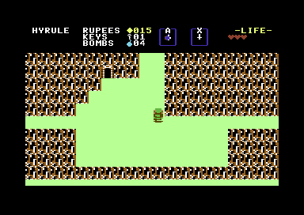 | 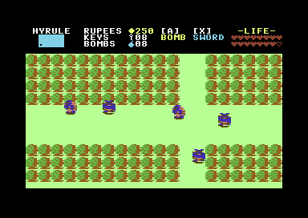 | 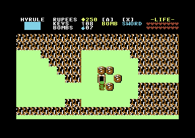 |

| Explosion Bombe 2×2 (48×42 px) | Cimetière (`B-3`, Tombe Épée Magique) | Grotte de l'Épée (`H-8`) |
| :---: | :---: | :---: |
| 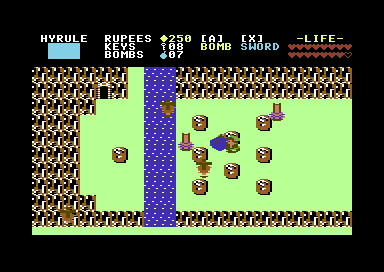 | 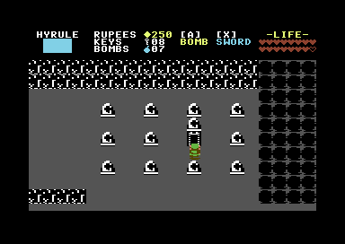 | 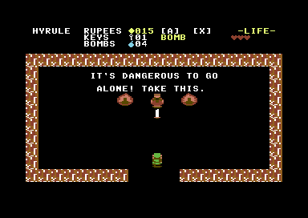 |

### Donjons, Énigmes & Fin du Jeu

| Donjon 1 (Stalfos) | Goriya Affamé (Donjon 7) | Antre de Ganon (Donjon 9) |
| :---: | :---: | :---: |
| 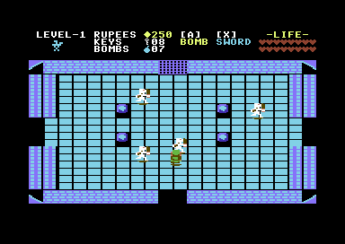 | 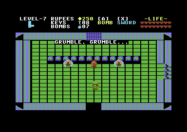 | 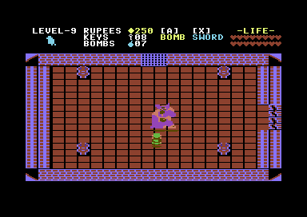 |

| Sauvetage de la Princesse Zelda | Écran Game Over / Continue | Menu Debug (3 Pages) |
| :---: | :---: | :---: |
| 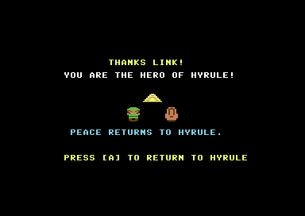 | 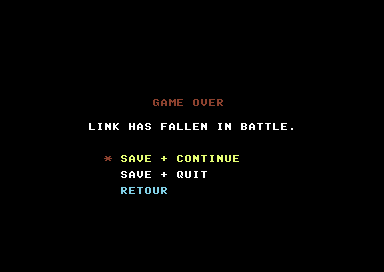 | 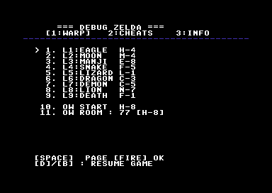 |

### Menus d'Inventaire & Carte du Monde (4 Pages)

| Arsenal & Reliques (Page 0) | Pyramide de la Triforce (Page 1) | Statut de Quête (Page 2) | Carte d'Hyrule 16×8 (Page 3) |
| :---: | :---: | :---: | :---: |
| 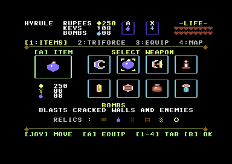 | 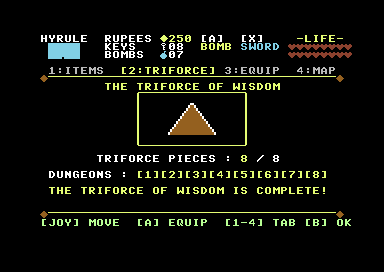 | 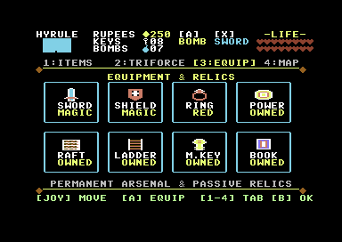 | 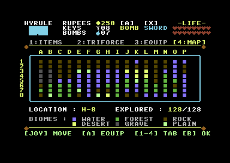 |

### Bestiaire Authentique & Grands Boss Multi-Sprites

| Aquamentus (D1) | Dodongo Orange (D2) | Manhandla (D3) |
| :---: | :---: | :---: |
| 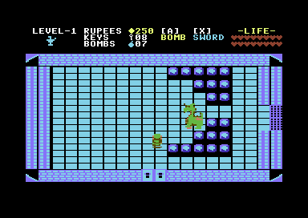 | 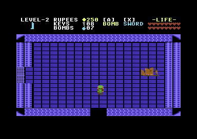 | 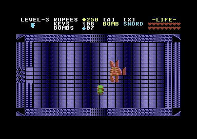 |

| Digdogger (D5) | Gohma (D6) | Gleeok (D8) |
| :---: | :---: | :---: |
| 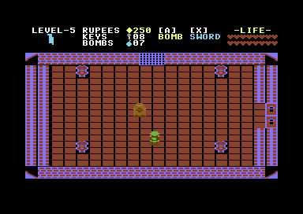 | 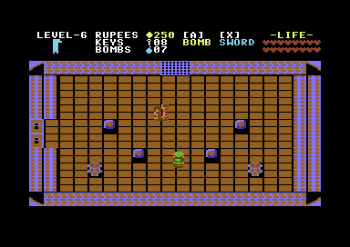 | 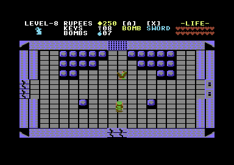 |

| Goriyas Rouges (D1) | Serpents Ropes (D2) | Chevaliers Darknuts (D3) |
| :---: | :---: | :---: |
| 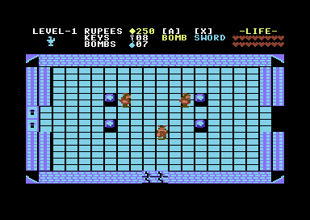 | 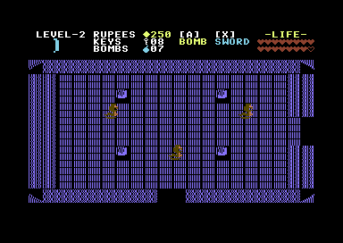 | 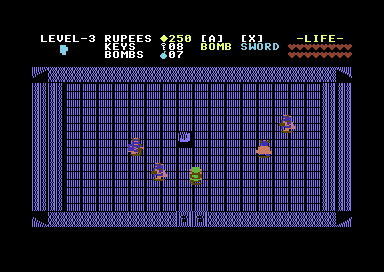 |

---

## 🎨 Atlas Graphique & Planches de Contact

L'outil autonome [`tools/export_assets_sheet.py`](tools/export_assets_sheet.py) génère les planches de contact pixel-art haute résolution (ratio 2:1 fidèle aux pixels multicolores C64) :

### Planche Maîtresse Consolidée (Master Atlas)
Rassemble les 16 tuiles mondes, 16 tuiles donjons, 31 sprites de Link et projectiles, 125 monstres et boss, 27 objets et 36 cycles d'animation :

[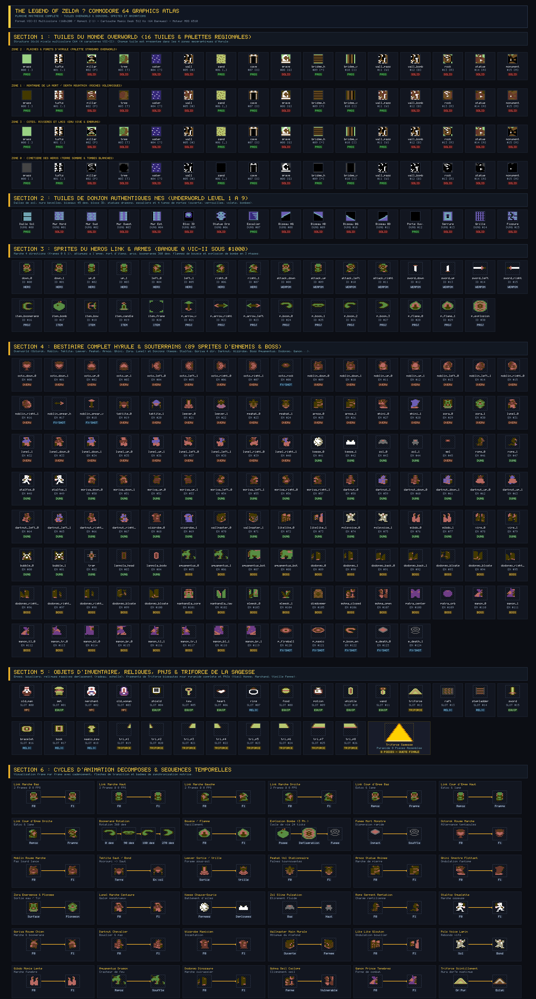](docs/images/atlas_all_assets.png)

### Planches Dédiées par Catégorie
* 🗺️ [**Planche des Tuiles (Overworld 4 zones & Donjons)**](docs/images/sheet_tiles.png) : 16 tuiles sous 4 palettes régionales et 16 dalles de donjon (`SOLID` / `PASS` / `WATER`).
* 🗡️ [**Planche de Link & Arsenal**](docs/images/sheet_sprites_link.png) : Déplacements 4 directions, poses d'attaque, port d'items, bombe, flèches, boomerang, flamme et vague magique.
* 👾 [**Planche du Bestiaire Monstres & Boss**](docs/images/sheet_sprites_enemies.png) : 125 sprites des ennemis Overworld, créatures souterraines et grands boss.
* 💎 [**Planche des Objets, Reliques & PNJs**](docs/images/sheet_sprites_items.png) : Armes, reliques passives, PNJs et pyramide de la Triforce.
* 🎞️ [**Planche des Cycles d'Animation Décomposés**](docs/images/sheet_animations.png) : 36 séquences animées frame par frame avec cadencements.

*(Pour regénérer l'ensemble des planches en quelques secondes : `make atlas`.)*

---

## 💾 Téléchargement Rapide & Lancement

1. Téléchargez la dernière version de la cartouche : **[`zelda.crt` (Dernière Release)](https://github.com/vedix95/ZELDAC64/releases/latest)**.
2. Lancez directement la cartouche dans [VICE](https://vice-emu.sourceforge.io/) :
   ```bash
   x64sc -cartcrt zelda.crt
   ```
   *(En mode Dual SID stéréo : `x64sc -cartcrt zelda.crt -sidextra 1 -sid2address 0xd420`)*

### Compilation depuis les Sources
```bash
# Dépendances requises : ACME cross-assembler, VICE et Python 3
make          # Assemble et génère build/zelda.crt (Magic Desk 512 Ko)
make run      # Lance le jeu immédiatement dans l'émulateur VICE
make atlas    # Génère toutes les planches graphiques PNG dans build/
make maps     # Rendu haute définition des cartes de l'Overworld et des 9 donjons
```

---

## 🕹️ Contrôles du Jeu

Le jeu se pilote au **Joystick Port 2** et/ou au clavier sous VICE ([`src/input.asm`](src/input.asm)) :

| Commande | Action |
| :--- | :--- |
| **Direction Joystick Port 2** | Déplacements de Link (Haut, Bas, Gauche, Droite) & poussée des rochers/blocs |
| **Touche `X` / `Espace`** (Bouton X) | Coup d'épée (et rayon laser à pleine vie) |
| **Bouton Feu Joystick** (Bouton A) | Utiliser l'objet secondaire actif `[A]` (Boomerang, Bombe, Arc, Bougie, Flûte, Viande, Potion, Baguette) |
| **Touche `B`** (Bouton B) | Ouvrir / Fermer l'inventaire 4 pages |
| **Touche `3`** | Basculer en temps réel entre **Mono SID (`$D400`)** et **Dual SID Stéréo (`$D420`)** |
| **Touche `D`** | Ouvrir le menu de téléportation, cheats et diagnostic (Debug 3 pages) |
| **Touche `G`** | Ouvrir le menu Game Over / Sauvegarde (`SAVE + CONTINUE`, `SAVE + QUIT`, `RETOUR`) |
| **Bouton Feu / `Espace`** (Intro) | Passer le menu SID ou accéder au File Select / lancer la partie |

---

## 🎵 Bande-Sonore Dual SID Stéréo (MOS 8580 — 48 kHz / 320 kbps)

La bande originale est enregistrée directement depuis la cartouche `zelda.crt` en **mode Dual SID Stéréo** (**SID 1 `$D400`** canal gauche + **SID 2 `$D420`** canal droit, puces **MOS 8580**, ReSID 48 kHz, MP3 **320 kbps Stéréo**).

> 🎧 **Lecteur Web Jukebox (4 pistes Stéréo) :** [**Ouvrir le Jukebox Dual SID Stéréo en ligne**](https://raw.githack.com/vedix95/ZELDAC64/main/docs/audio/index.html) *(ou ouvrir [`docs/audio/index.html`](docs/audio/index.html) en local)*.

| Piste & Ambiance | Description (Dual SID `$D400` + `$D420`) | Lecteur Direct / MP3 320k | Clip Stéréo MP4 |
| :--- | :--- | :---: | :---: |
| 📜 **Thème d'Introduction & Titre** *(0:46)* | Fanfare d'ouverture, cascade animée et Légende d'Hyrule en chœur stéréo Dual SID. | <audio controls preload="none" src="docs/audio/zelda_intro.mp3"><a href="https://raw.githubusercontent.com/vedix95/ZELDAC64/main/docs/audio/zelda_intro.mp3">▶ Écouter MP3 320k</a></audio> | [🎬 MP4 Stéréo](https://github.com/vedix95/ZELDAC64/releases/download/v0.25/zelda_intro_dual_sid.mp4) |
| 🛡️ **Thème Overworld (Aventure)** *(0:50)* | Boucle complète Parties 1 & 2 avec spatialisation SID1/SID2 et basse bondissante Voix 3. | <audio controls preload="none" src="docs/audio/zelda_overworld.mp3"><a href="https://raw.githubusercontent.com/vedix95/ZELDAC64/main/docs/audio/zelda_overworld.mp3">▶ Écouter MP3 320k</a></audio> | [🎬 MP4 Stéréo](https://github.com/vedix95/ZELDAC64/releases/download/v0.25/zelda_overworld_dual_sid.mp4) |
| 🗝️ **Thème des Donjons (D1–D8)** *(0:42)* | Arpèges Pulse 50 % spatialisés entre les deux puces SID et basse sourde souterraine. | <audio controls preload="none" src="docs/audio/zelda_dungeon.mp3"><a href="https://raw.githubusercontent.com/vedix95/ZELDAC64/main/docs/audio/zelda_dungeon.mp3">▶ Écouter MP3 320k</a></audio> | [🎬 MP4 Stéréo](https://github.com/vedix95/ZELDAC64/releases/download/v0.25/zelda_dungeon_dual_sid.mp4) |
| 🔥 **Thème du Donjon 9 — Death Mountain** *(0:42)* | Thème étendu 124 pas streamé depuis la Banque Cartouche 31 pour la forteresse de Ganon. | <audio controls preload="none" src="docs/audio/zelda_dungeon9.mp3"><a href="https://raw.githubusercontent.com/vedix95/ZELDAC64/main/docs/audio/zelda_dungeon9.mp3">▶ Écouter MP3 320k</a></audio> | [🎬 MP4 Stéréo](https://github.com/vedix95/ZELDAC64/releases/download/v0.25/zelda_dungeon9_dual_sid.mp4) |

*(Note : Les lecteurs `<audio>` s'affichent directement dans VS Code, les visionneuses Markdown et le [Jukebox Web](https://raw.githack.com/vedix95/ZELDAC64/main/docs/audio/index.html) ; sur GitHub, cliquez sur **▶ Écouter MP3 320k** ou sur le **Jukebox Dual SID** pour lancer la lecture instantanément.)*

---

## 📚 Documentation Technique Approfondie

* 📖 [**Documentation d'Architecture Système (`DOCUMENTATION.md`)**](./DOCUMENTATION.md) : Cartographie 64 Ko, cartouche Magic Desk 512 Ko, cache d'overlays `loaded_overlay_bank`, multiplexeur VIC-II et moteur Dual SID.
* ✅ [**Cahier de Recettes & QA (`docs/cahier_de_recettes.md`)**](./docs/cahier_de_recettes.md) : Protocoles de validation 50 FPS PAL, plafonds mémoire et matrice de traçabilité complète des **32 anomalies résolues**.
* 🐛 [**Registre des Anomalies & Correctifs (`bugs.md`)**](./bugs.md) : Historique détaillé des 32 bugs analysés et corrigés sur matériel C64.
* 🛡️ [**Directives & Invariants Techniques (`AGENTS.md`)**](./AGENTS.md) : 16 garde-fous techniques stricts sur les interruptions raster, la mémoire résidente, les collisions et le SID.

---

## Mentions Légales & Droits d'Auteur

*The Legend of Zelda*, ainsi que les personnages, logos, musiques et graphismes associés sont des marques déposées et propriétés exclusives de **Nintendo Co., Ltd.**

Ce projet est un travail d'hommage bénévole, non-commercial et éducatif conçu par un passionné d'informatique rétro assisté par son IA préférée issue de chez Google afin d'explorer les limites matérielles du Commodore 64. Il n'est en aucune manière affilié à, autorisé ou approuvé par Nintendo.
