# The Legend of Zelda — Port C64

[](https://github.com/vedix95/ZELDAC64/releases)
[](https://github.com/vedix95/ZELDAC64/actions)
[](https://en.wikipedia.org/wiki/Commodore_64)
[](https://sourceforge.net/projects/acme-crossass/)
[](LICENSE)

Une récréation fidèle et authentique du chef-d'œuvre classique **The Legend of Zelda** (1986) pour l'ordinateur 8-bits **Commodore 64**, entièrement programmée en assembleur 6510 pour l'assembleur [ACME](https://sourceforge.net/projects/acme-crossass/) et testée avec l'émulateur [VICE](https://vice-emu.sourceforge.io/).

> *Ce projet est la création d'un passionné d'informatique rétro réalisée à l'aide de son IA préférée issue de chez Google.*

---

## 💾 Téléchargement Direct & Releases

### Latest Release (v0.17)

- **[Télécharger l'image cartouche v0.17 (`zelda.crt`)](https://github.com/vedix95/ZELDAC64/releases/latest)** - Grande Pyramide de la Triforce Authentique NES (96x42), Cadres d'Inventaire Redimensionnés sans Débordement, 6 Reliques Passives, Clé Magique Lion et Clignotement de Link Monocase.
- Previous releases are available in the [GitHub Releases](https://github.com/vedix95/ZELDAC64/releases) section.

---

## 💾 Téléchargement Direct & Releases (v0.10.1)
- ⚡ **Cartouche Magic Desk 256 Ko avec Streaming ROM Instantané (0 délai)** : La cartouche `zelda.crt` rassemble l'introduction cinématique complète (cascade animée, parchemin, blason, musique SID, bestiaire), le moteur résident, les 4 chunks régionaux de l'Overworld et les 9 Donjons complets, streamés instantanément en RAM ($C000) sans aucun temps de chargement.
- 🏰 **Intégration Complète des 9 Donjons & Tous les Boss NES** : Tous les donjons de Zelda 1 (Niveaux 1 à 9) sont intégrés avec leurs énigmes, volets, portes à clés, salles de la Triforce et l'ensemble de leurs Boss (Aquamentus, Dodongos, Manhandla, Gleeok, Digdogger, Gohma et l'antre de Ganon au Donjon 9).
- 🗺️ **Rochers Escargots, Secret Moblin & Générateur de Cartes PNG** : Zone D-4 enrichie avec les rochers spirales authentiques NES et la grotte secrète déblocable au Bracelet de Force. Outil de rendu PNG complet pour analyser l'Overworld et chaque donjon (`make maps`).
- 🛠️ **Nouveautés v0.10.1** : Abandon de la version disquette au profit de la cartouche exclusive Magic Desk 256 Ko (gain de plus de 450 octets de RAM en Zone 3), transition instantanée intro vers gameplay, sécurisation des interruptions lors de la copie mémoire, suppression de l'éditeur web et unification des outils d'analyse de cartes.

Pour lancer directement la cartouche dans [VICE](https://vice-emu.sourceforge.io/) :
```sh
x64sc -cartcrt zelda.crt
```

---

## Captures d'écran

### En jeu (Overworld, Donjons, Grottes, Monstres & Boss)

| Overworld & Radar GPS | Entrée du Donjon 1 (L'Aigle) |
| :---: | :---: |
|  |  |

| Combat contre le Boss Aquamentus | Salle des Monstres Stalfos (Donjon 1) |
| :---: | :---: |
|  |  |

| Écran D-4 (10 Rochers Escargot Authentiques) | Poussée du Rocher au Bracelet de Force |
| :---: | :---: |
| 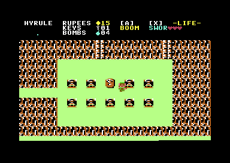 | 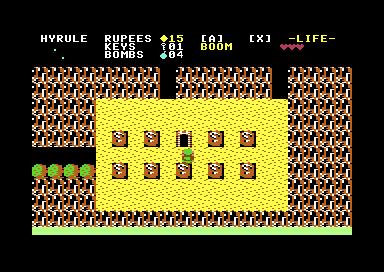 |

| Grotte de l'Épée de Bois (Vieil Homme) | Célébration Fanfare Récupération Épée |
| :---: | :---: |
|  | 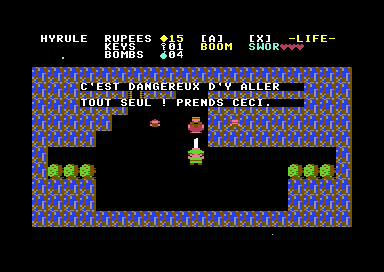 |

| Salle de départ & Grotte de l'Épée | Cimetière avec Ghinis | Désert avec Peahats |
| :---: | :---: | :---: |
|  |  |  |

### Galerie : Overworld, Donjons, Boss & Menus

**Overworld**

| Côte | Forêt | Lac |
| :---: | :---: | :---: |
| 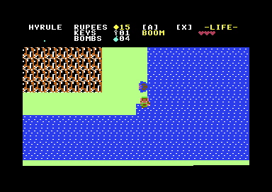 | 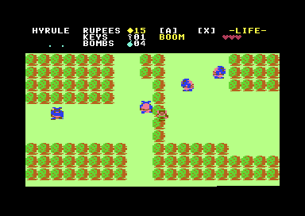 | 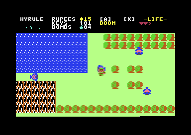 |

| Cascade | Death Mountain | Entrée Donjon 2 |
| :---: | :---: | :---: |
| 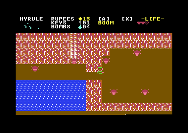 | 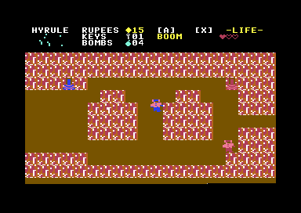 | 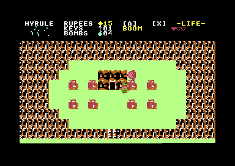 |

**Donjons (entrées)**

| Donjon 2 — La Lune | Donjon 3 — Manji | Donjon 4 — Le Serpent |
| :---: | :---: | :---: |
| 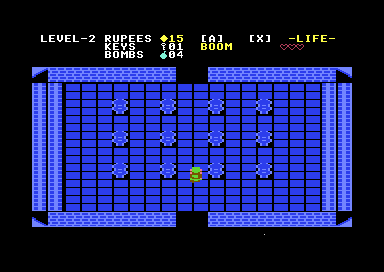 | 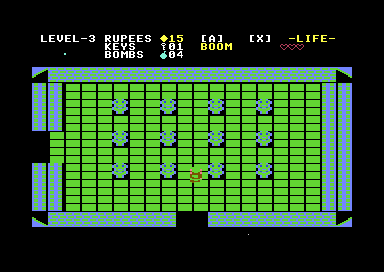 | 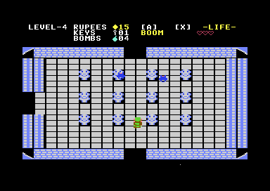 |

| Donjon 5 — Le Lézard | Donjon 6 — Le Dragon | Donjon 7 — Le Démon |
| :---: | :---: | :---: |
| 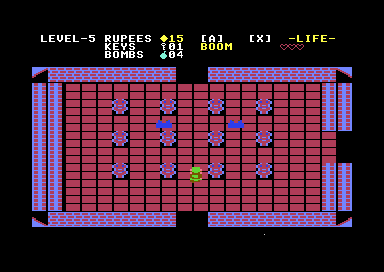 | 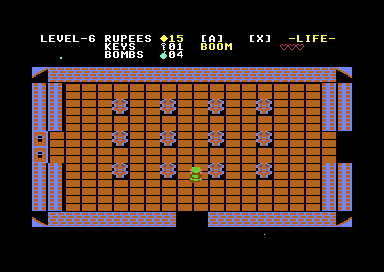 | 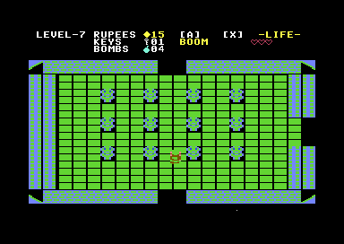 |

| Donjon 8 — Le Lion | Donjon 9 — Death Mountain |
| :---: | :---: |
| 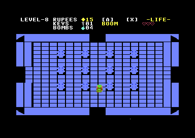 | 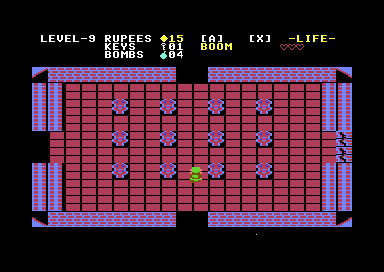 |

**Boss**

| Dodongo (D2) | Manhandla (D3) | Gleeok (D4) |
| :---: | :---: | :---: |
| 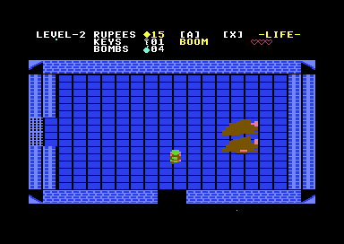 | 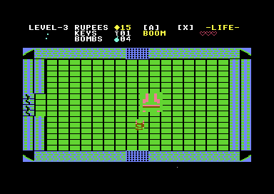 | 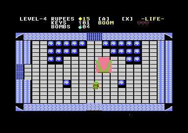 |

| Digdogger (D5) | Gohma (D6) | Ganon (D9) |
| :---: | :---: | :---: |
| 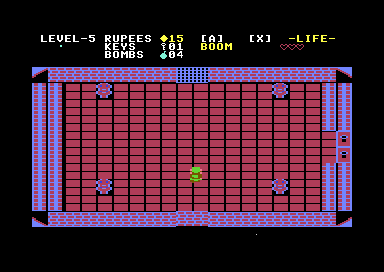 | 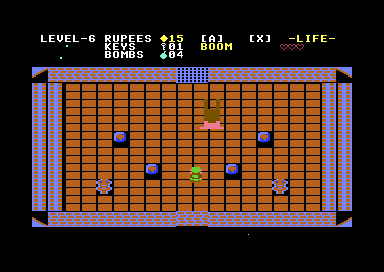 |  |

**Inventaire & Menu Debug**

| Objets | Triforce | Équipement |
| :---: | :---: | :---: |
|  |  | 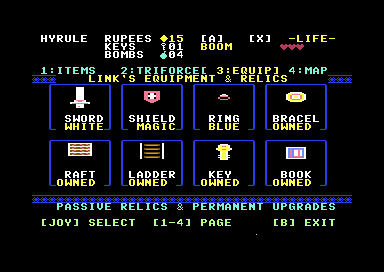 |

| Carte du monde | Menu Debug (Warp) |
| :---: | :---: |
|  | 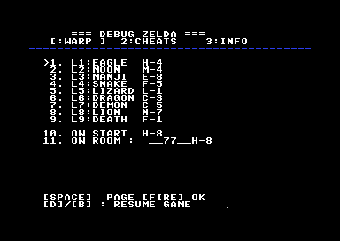 |

### Cinématique d'Introduction Authentique (Chute d'eau, Parchemin & Bestiaire)

| Écran Titre & Cascade Animée | Déroulement de la Légende d'Hyrule | Présentation de tous les Trésors | Défilé des Monstres (Ghini) |
| :---: | :---: | :---: | :---: |
|  |  |  |  |

| Carte complète de l'Overworld (16×8 écrans — 128 salles) |
| :---: |
|  |

---

## 🎵 Bande-Sonore SID & Extraits Audio MP3

Les musiques du jeu ont été fidèlement retranscrites et synthétisées directement sur la puce sonore analogique **MOS SID 6581/8580** du Commodore 64 à partir des partitions originales NES. Enregistrement direct sous émulation cycle-accurate reSID (48 kHz, 192 kbps) :

| Piste & Scène | Description | Écoute directe | Fichier MP3 |
| :--- | :--- | :---: | :---: |
| 🛡️ **Thème Overworld (Aventure)** | La boucle légendaire d'exploration d'Hyrule, avec sa ligne de basse profonde Voice 3 calibrée à l'octave exacte sans suraigus. | <audio controls src="docs/audio/zelda_overworld.mp3"></audio> | [zelda_overworld.mp3](docs/audio/zelda_overworld.mp3) |
| 🗝️ **Thème des Donjons (Underworld)** | L'atmosphère mystérieuse des Labyrinthes 1 à 8, avec ses arpèges G-mineur entrelacés en onde Pulse 50% sur 2 voix et basse sourde. | <audio controls src="docs/audio/zelda_dungeon.mp3"></audio> | [zelda_dungeon.mp3](docs/audio/zelda_dungeon.mp3) |
| 📜 **Thème d'Introduction & Titre** | La partition épique de l'écran-titre avec cascade et du défilement de la Légende d'Hyrule. | <audio controls src="docs/audio/zelda_intro.mp3"></audio> | [zelda_intro.mp3](docs/audio/zelda_intro.mp3) |

---

## Points forts & Fonctionnalités (Nouveautés v0.17 — Grande Pyramide Triforce NES, Restructuration Menu, Clé Magique & Carte Monocase)

- 👑 **Grande Pyramide de la Triforce Authentique NES (Page 2: TRIFORCE)** :
  - **Assemblage physique complet 96×42 pixels** : Émulation exacte du schéma original de *The Legend of Zelda* NES (`inventaire.png`). La Grande Pyramide est assemblée par 8 sprites matériels VIC-II biseautés et étincelants en or pur (`COL_YELLOW`, `COL_ORANGE`, `COL_WHITE`), s'illuminant au fur et à mesure de la conquête des 8 Donjons.
  - **Typographie et socle officiels** : Label officiel `"TRIFORCE"` centré à la ligne 14 sous la pyramide, indicateurs de progression par niveau [1]..[8] et compteur de fragments dynamiques.
- 🏛️ **Restructuration Exacte du Menu d'Objets & Reliques Passives (Page 1: ITEMS)** :
  - **Ajustement parfait du cadre sans débordement** : Boîte des armes B redimensionnée avec précision à 18 colonnes (Cols 13..31), offrant une marge de sécurité de 4 à 8 pixels : aucun sprite ne déborde ni ne touche les bordures.
  - **Disposition fidèle à `inventaire.png`** : Cadre dédié à l'arme équipée à gauche (`"INVENTORY"`, `"USE B BUTTON / FOR THIS"`), boîte spacieuse des 8 armes utilisables à droite et rangée d'honneur supérieure accueillant les 6 Reliques Passives (Radeau, Livre, Anneau, Échelle, Clé Magique, Bracelet) avec leurs glyphes et couleurs dynamiques.
  - **Navigation 2D directionnelle au Joystick** : Déplacement libre Haut / Bas / Gauche / Droite dans la grille 4×2 d'objets.
  - **Ordre d'arsenal officiel NES** : Boomerang, Bombe, Arc & Flèche, Bougie, Flûte, Nourriture, Potion de Vie, Baguette Magique.
- 🗝️ **Clé Magique Dédiée (Lion Key) & Bannissement de la Petite Clé** :
  - Intégration du sprite haute résolution à tête de lion authentique NES (`sprite_link_item_magic_key`) pour la Clé Magique dans la liste des reliques passives et équipements permanents, éradiquant l'affichage erroné de la petite clé de donjon.
- 🗺️ **Carte du Monde Topologique 16×8 avec Clignotement Link Monocase (Page 4: MAP)** :
  - **Correction du clignotement double case** : Chaque salle de la carte Overworld est désormais matérialisée par un bloc unique délimité par un espace, garantissant que le clignotement de la position de Link n'affecte strictement qu'une seule case nette.
  - **Lecture intuitive des 6 biomes** : Couleurs topologiques en jeu direct (Montagne, Forêt, Océan/Rivières, Désert, Cimetière, Plaine).
  - **Rendu topologique fidèle de l'Overworld (128 salles)** : Remplacement de l'ancien damier monochrome vert par les 6 vraies teintes de biomes officielles extraites directement de `assets/world.txt` et de la ROM originale :
    - 🌊 **Eau, Lacs & Océan (`COL_LIGHT_BLUE`)** : Rivière Zora, cascades, Lac Hylia et grand océan oriental.
    - 🌲 **Forêts & Bois Perdus (`COL_GREEN`)** : Frondaisons épaisses et clairières sylvestres.
    - ⛰️ **Montagne de la Mort & Roches (`COL_BROWN`)** : Pics escarpés et massifs rocheux du nord.
    - 🏜️ **Désert & Rivages Côtiers (`COL_YELLOW`)** : Étendues de sable chaud.
    - 🪦 **Cimetière Royal (`COL_DARK_GREY`)** : Les 6 salles sacrées des pierres tombales hantées de Ghinis.
    - 🌿 **Plaines & Vallées (`COL_LIGHT_GREEN`)** : Clairière de départ, prairies et fontaines des fées.
  - **Légende couleur sur 2 lignes, coordonnées matricielles (`LOCATION : H-8`) et compteur précis d'exploration (`EXPLORED: 43 / 128`)**.
- 🎶 **Moteur Audio Dual SID Stéréo ($D420) & File d'Attente Prioritaire Anti-Conflit** :
  - **Sérialisation absolue des sons simultanés** : Épée, clés et carillon de secret ne se coupent plus mutuellement. Tout son déclenché pendant la lecture d'un autre est automatiquement mis en file d'attente prioritaire (`sfx_pending_idx` / `secret_chime_pending`) et s'exécute immédiatement à la suite sans voler la basse ni corrompre les voix stéréo.

- **Conversion 1:1 Authentique Tuile par Tuile de l'Overworld NES (`assets/world.txt`)** :
  - **Grille exacte 1:1 sans aucune perte** : Mappage direct des 16 colonnes NES (0..15) sur les colonnes 2..17 du C64 et des 8 lignes intérieures NES (1..8) sur les lignes 1..8 du C64. Éradication complète des duplications de colonnes et des suppressions de rangées qui déformaient la carte et décalaient les événements.
  - **Intégration de la totalité des 90 tuiles NES extraites de `zelda.nes`** : Restitution de tous les rochers en spirale/escargot (`22` / `TILE_ROCK`), rochers poussables (`01`), statues Armos (`16`), 72 pierres tombales (`21` / `TILE_GRAVE`), 24 entrées de grottes (`12`, `9c` / `TILE_CAVE`), ponts horizontaux/verticaux et rivières.
  - **Repères exacts de tous les secrets officiels** : Murs fissurés aux bombes (dont l'œil gauche de Spectacle Rock menant au Donjon 9), passage secret traversable P-1/P-2, assèchement du lac au sifflet pour le Donjon 7 et arbres calcinables à la bougie.
- **Mécanique des Rochers Escargot & Bracelet de Force Authentique (`D-4`, `D-3`, `J-5`, `J-8`, `N-2`)** :
  - Restitution des **10 rochers escargot** en écran D-4 (salle 51) et dans l'écran C-3 (salle 34).
  - Poussée vers le haut (`DIR_UP`) du rocher central avec le **Bracelet de Force** pour révéler le passage/escalier secret (`TILE_CAVE`), avec déclenchement de la fanfare secrète et mémorisation persistante dans l'état de sauvegarde.
- **Résolution Définitive des Glitches de Grottes (`src/cave.asm`)** :
  - Éradication de toute persistance d'éléments de l'écran précédent lors de l'entrée dans une caverne : purge complète des 8 slots d'ennemis, extinction et désactivation de tous les sprites VIC-II, effacement total de l'écran (`clear_screen`), réinitialisation de la palette à fond noir et padding complet des lignes de texte sur 28 caractères.
  - Sortie de grotte propre restituant Link à l'extérieur avec réinitialisation du HUD, rechargement des banques de sprites et reprise sans saccade de la bande-sonore.
- **Résilience Audio SID à 3 Canaux (`src/sound.asm`)** :
  - Correction définitive du bug où la musique ne laissait qu'un seul canal actif.
  - Sécurisation des prolongations de notes ($FE / HOLD) avec maintien actif de la porte Gate ON sur les voix 2 et 3, suppression des coupures intempestives de la Voix 2, protection contre l'écrasement des pas musicaux lors des jingles secrets, et sécurisation de la touche de bascule Dual SID.

---

## Points forts & Fonctionnalités (Versions Précédentes)

- **Intégration Complète des 9 Donjons & de tous les Boss NES (v0.9.0)** :
  - **9 Donjons 100% Fonctionnels (`DUNG1` à `DUNG9`)** : Architecture complète des salles étanches, portes verrouillées à clés, portes à volets automatiques, énigmes de blocs mobiles, pièges, salles de la Triforce et trésors.
  - **Tous les Boss de Zelda 1 Implémentés** : Combats contre Aquamentus (N1 & N7), Dodongos (N2 & N8), Manhandla à 4 têtes (N3), Gleeok le dragon bicéphale (N4), Digdogger (N5), Gohma à l'œil unique (N6) et l'antre suprême de Ganon (N9).
  - **Distribution Disquette Double Face / 2 Disquettes** : Création automatique des images disquettes séparées `zelda_disk1.d64` (Overworld) et `zelda_disk2.d64` (Donjons) pour une compatibilité matérielle optimale 1541, en plus de l'image disquette tout-en-un `zelda.d64`.
- **Refonte Complète du Menu d'Inventaire (4 Onglets Haute Résolution)** :
  - **Onglet 1 (Objets B)** : Grille de sélection des 8 armes secondaires avec cadre bleu, boîte d'équipement active, descriptifs détaillés et compteurs de rubis, clés et bombes sans aucun chevauchement.
  - **Onglet 2 (Triforce)** : Grand triangle doré de la Triforce avec mise en surbrillance des fragments récupérés et compteurs de donjons complétés.
  - **Onglet 3 (Arsenal & Reliques Passives)** : Présentation claire des 8 reliques héroïques permanentes (Épée, Bouclier avec véritable sprite d'écu royal, Anneau, Bracelet, Radeau, Échelle, Clé magique et Livre de sorts).
  - **Onglet 4 (Carte Dynamique)** : Affichage automatique de la carte d'Hyrule (16×8) en Overworld ou du plan cartographié du donjon actif avec position de Link, boussole, salle du boss et nom du donjon.
  - **Éradication de la corruption CIA1** : Tracé haute résolution direct sans écrasement des registres de la puce d'E/S CIA1 et bordures nettes en graphismes 164.
- **Menu Debug Multifonctions 3 Pages Entièrement Fiabilisé** :
  - **Page 0 (Téléportation)** : Accès instantané aux 9 Donjons et à n'importe quelle salle de l'Overworld (A-1 à P-8 / 0 à 127). La sortie du donjon ramène Link exactement à l'entrée Overworld officielle du donjon.
  - **Page 1 (Arsenal & Triche)** : Full gear, soin instantané, ajustement des cœurs max, modification des épées, boucliers, anneaux, clés (+5), bombes (+4), rubis (+50) et pièces de Triforce (+1).
  - **Page 2 (Diagnostic & Hardware)** : Coordonnées subpixel de Link, orientation, ID de salle, types d'ennemis actifs, état de la mémoire et bascule Dual SID en temps réel.
  - **Correction du Défilement Intempestif** : Suppression de l'inversion de polarité joystick dans le menu debug (`beq` vs `bne`), temporisation anti-rebond unifiée et affichage propre sans duplication de lignes.
- **Correctifs Cave Souterraine, SFX Épée, Escalier Donjon & Rugissement du Boss (v0.8.9)** :
  - **Rendu complet de la Cave Souterraine (`STATE_CELLAR`, salle `0x22`)** : Correction de la boucle de remplissage des 200 tuiles de briques (`cpx #200` au lieu de `bpl` signé sur `199`), correction de la colonne d'échelle avec motif 2D authentique à barreaux (`cellar_ladder_char_l` / `r`) et piédestal central en briques.
  - **Correction du bruitage d'épée et des SFX (`sound.asm`)** : Séparation des instructions `jmp play_sfx_v3` (qui étaient interprétées comme commentaires après `;` par ACME et tombaient dans `sound_item_fanfare`), restituant le vrai bruitage de coup d'épée (`SFX_SWORD`) et tous les effets sonores.
  - **Escalier secret au centre du diamant (`0x22`) & Tuile d'escalier descendant** : En poussant le bloc gauche du losange (`offset 88` -> `68`), la case `88` devient du sol (`TILE_DUNG_FLOOR`) pour laisser Link entrer au cœur du diamant où se trouve l'unique escalier (`offset 90`), doté d'un nouveau graphisme 3D de marches descendantes (`TILE_DUNG_STAIRS`).
  - **Respiration / Rugissement du Boss (`SFX_BOSS_ROAR`)** : Ajout de l'effet sonore périodique de respiration/rugissement grave d'Aquamentus (`sound_boss_roar`) pendant le combat.
- **Correctifs Gameplay, Audio & Donjon 1 (v0.8.8)** :
  - **Collisions d'eau Overworld corrigées** : L'eau de l'Overworld (`TILE_WATER`) bloque désormais strictement Link tant qu'il ne possède pas l'Échelle (`Stepladder`).
  - **Sprite & Célébration de la Triforce (`0x36`)** : Ajout du véritable sprite triangulaire doré scintillant de la Triforce (`sprite_link_item_triforce`) sur le piédestal et brandi au-dessus des mains de Link pendant la célébration.
  - **Fanfares Authentiques NES 3 Voix (`SongScriptItemTaken0` & `SongScriptEndLevel0`)** : Extraction directe depuis `zelda.nes` de la fanfare de récupération d'objet (avec reprise automatique de la musique de fond) et de la fanfare complète de victoire de la Triforce (41 pas sur 3 voix SID).
  - **Récompense du Boss Aquamentus (`0x35`)** : Correction de la mort d'Aquamentus à l'épée, ouverture automatique de la porte à volet Est et apparition garantie du **Conteneur de Cœur (`DROP_HEART_CONTAINER`)**.
  - **Salle Souterraine de l'Arc (`0x22` / `STATE_CELLAR`)** : Rendu fidèle de la chambre souterraine en briques blanches/grises sur fond noir de la NES avec échelle, piliers, piédestal central et récupération de l'Arc.
- **Optimisation Mémoire C64 & Streaming Disquette par Chunks (`OW0`–`OW3` & `DUNG1`–`DUNG9`)** :
  - **Découpage de l'Overworld en 4 Chunks (`OW0` à `OW3`)** : L'Overworld (128 salles) est découpé en 4 bandes horizontales de 32 salles (~2,8 Ko chacune) chargées automatiquement à la demande depuis la disquette 1541.
  - **Déduplication des tables d'ennemis (`room_enemy_idx`)** : Compression de 55% des fichiers de donjons (~2,1 Ko au lieu de 5 Ko) et des chunks Overworld grâce à l'indexation des formations uniques de monstres.
  - **Gain massif de +8 Ko de RAM résidente (`$A000`–`$BFFF`)** : La fenêtre d'overlay dynamique est réduite de 12 Ko (`$A000`–`$CFFF`) à 4 Ko (`$C000`–`$CFFF`), libérant près de 8 Ko de mémoire vive pour le moteur et les futures fonctionnalités.
- **Musique Continue 50 Hz sous Interruption Raster (`irq_bottom`)** :
  - Le séquenceur musical SID (`music_update`) est désormais exécuté directement dans l'interruption raster matériel à 50 Hz. La musique continue de jouer avec une fluidité absolue sans aucun blocage ni saccade pendant tous les défilements (push-scroll) d'écran à écran, en Overworld comme en Donjon.
- **Donjon 1 (L'Aigle) — Secrets de Blocs Poussables, Ermite & Cave Vue de Côté (2D)** :
  - *Note : Seul le Donjon 1 est implémenté partiellement pour le moment.*
  - **Mécanique authentique de poussée de blocs** : Après avoir éliminé tous les ennemis d'une salle à énigme, maintenir une direction contre le bloc central pendant ~16 frames déclenche son déplacement avec le jingle secret (`SFX_SECRET`).
  - **Salle de l'Ermite (`0x41`) & Énigme de la Salle `0x42`** : Vaincre les Gels en `0x42` puis pousser le bloc central ouvre le volet Ouest vers la salle `0x41` où l'ermite entouré de torches animées révèle l'indice officiel : *"LA PENINSULE TOUT A L'EST / EST LE SECRET."*.
  - **Cave Souterraine Vue de Côté (`STATE_CELLAR`) & Récupération de l'Arc (`0x22`)** : Vaincre les Keese en `0x22` puis pousser le bloc révèle l'escalier secret menant au sous-sol 2D classique en briques. Link descend l'échelle, marche jusqu'au piédestal central, brandit l'**Arc (`ITEM_BOW`)** au-dessus de sa tête avec la fanfare d'objet, puis remonte l'échelle vers la salle `0x22`.
- **Boss Aquamentus Géant Haute Fidélité (`48×42` pixels)** :
  - Extraction directe des tuiles CHR NES `bos1` depuis `zelda.nes` combinée à l'expansion matérielle 2× en X et en Y du VIC-II (`VIC_SPRITE_EXP_X` / `VIC_SPRITE_EXP_Y`), donnant à Aquamentus sa stature imposante face à Link avec boîtes de collision et point de crachat des triples boules de feu ajustés.
- **Moteur Audio SID & Support Dual SID ($D420 stéréo)** :
  - Touche `3` en jeu pour basculer instantanément en mode stéréo Dual SID.
- **HUD sur fond noir, Mini-carte 1:1 & Générateur de Cartes PNG Haute Résolution** (`make maps`).

---

## Prérequis

Sur les distributions basées sur Arch Linux :
```sh
sudo pacman -S acme vice python python-pillow
```

Sur Debian / Ubuntu :
```sh
sudo apt-get update
sudo apt-get install -y acme vice python3 python3-pil
```

Vérifier la configuration de votre environnement de développement :
```sh
make check
```

---

## Compilation et Lancement

| Commande | Action |
| :--- | :--- |
| `make` | Compile le projet complet et génère l'image cartouche `build/zelda.crt` (Magic Desk) |
| `make run` | Lance directement le jeu cartouche dans VICE (Intro cinéma + streaming instantané) |
| `make debug` | Lance dans VICE avec chargement automatique des labels symboliques (`build/zelda.vs`) |
| `make maps` | Génère les images PNG haute résolution de l'Overworld et des 9 Donjons pour analyse |
| `make preview` | Génère les aperçus graphiques PNG des sprites et du monde dans `build/` |
| `make clean` | Nettoie les fichiers de build temporaires (`build/`) |
| `make distclean` | Nettoie les fichiers de build et les fichiers ASM générés |

---

## Contrôles

### En jeu (Joystick Port 2 ou Clavier)

Le jeu se joue idéalement avec une manette ou un joystick branché sur le **Port 2**. Dans VICE, configurez le joystick dans `Settings > Input devices > Joystick > Joystick #2` (clavier ou manette USB).

| Touche / Action | Rôle |
| :--- | :--- |
| **Joystick Direction** / Pavé numérique | Déplacements de Link (Haut, Bas, Gauche, Droite) |
| **Bouton Feu** / `X` | Coup d'épée (et tir d'épée si PV au maximum) |
| `A` | Utiliser l'arme secondaire active (Boomerang, Bombe, Arc, Bougie) |
| `B` | Ouvrir / Fermer le menu d'inventaire |
| `D` | Ouvrir / Fermer le moniteur de debug (mémoire, registres VIC-II / SID) |
| `3` | Basculer mode Dual SID ($D420 stéréo) / Mono SID ($D400) |
| `Espace` / `Entrée` | Valider / Passer l'écran d'introduction |

---

## Architecture de la Cartouche C64 (`zelda.crt` - Magic Desk 256 Ko)

La cartouche Magic Desk (Type 19) utilise 32 banques de 8 Ko commutables à `$8000`–`$9FFF` :

1. **Banque 00** : Bootloader cartouche (`cart_boot.asm`, vecteurs matériels CBM80), initialise la machine et déballe l'introduction.
2. **Banques 01..03** : Introduction cinématique complète (`intro.prg`, $0800..$6800), cascade, parchemin vertical, blason NES et bestiaire.
3. **Banques 04..09** : Moteur résident principal du jeu (`zelda.prg`, $0800..$C800), déballé en RAM en 0.2s lors du passage de l'intro.
4. **Banques 10..13** : Les 4 chunks régionaux de l'Overworld (`OW0` à `OW3`), streamés instantanément en ROM à `$C000`.
5. **Banques 14..22** : Les 9 donjons complets d'Hyrule (`DUNG1` à `DUNG9`), streamés instantanément à `$C000`.
6. **Banques 23..31** : Banques libres (72 Ko d'espace disponible pour extensions).

### Carte mémoire du C64

```
+------------------+ $FFFF
| Vecteurs KERNAL  |
+------------------+ $E000
| ROM KERNAL / I/O | $D000 - $DFFF : Registres VIC-II, SID 1 ($D400), SID 2 ($D420), CIA 1/2, Color RAM
+------------------+ $D000
| Fenêtre Overlay  | $C000 - $CFFF : Chunk Overworld (OW0..OW3) ou Donjon (DUNG1..DUNG9) actif (4 Ko)
+------------------+ $C000
| Tampons Salles   | $BE00 - $BF8F : Tampons RAM décompressés (room_buf & target_room_buf)
| RAM Résidente    | $0801 - $BDFF : Code moteur, IA, cave 2D, HUD, audio SID (~7,5 Ko libres en $A091-$BDFF)
+------------------+ $2000 - $27FF : Jeu de caractères multicolore des tuiles (Charset)
| Mémoire écran    | $0400 - $07E7 : Matrice d'écran vidéo VIC-II ($07F8-$07FF : Pointers sprites)
+------------------+ $0400
| Zone système     | $0200 - $03FF : Vecteurs KERNAL/BASIC, état des salles donjon ($033C)
| Pile processeur  | $0100 - $01FF : Pile matérielle 6502
| Page Zéro ($00)  | $0002 - $00FF : Pointeurs rapides, état du joueur, registres virtuels
+------------------+ $0000
```

---

## Arborescence du Projet

```
.
├── assets/                     # Fichiers sources d'assets (ASCII art, textes, MIDI)
│   ├── link.txt                # Sprites multicolores de Link (4 directions + attaque)
│   ├── enemies.txt             # Sprites multicolores des ennemis et boss
│   ├── extra.txt               # Sprites du Vieil Homme, objets et effets
│   ├── tiles.txt               # Définition des tuiles 16x16 et palettes multicolores
│   ├── world.txt               # Carte Overworld complète (16x8 écrans, 128 salles)
│   ├── underworld.txt          # Carte des donjons Underworld (Level 1)
│   └── *.mid                   # Fichiers MIDI sources transcrits pour le SID
├── docs/                       # Documentation et médias
│   ├── audio/                  # Enregistrements audio SID authentiques (MP3 192k)
│   └── images/                 # Captures d'écran et aperçus pour GitHub
├── LegendOfZeldaNESRecomp/     # Référence complète du décompilateur Zelda NES
├── scripts/                    # Scripts utilitaires shell (vérification d'environnement)
│   └── check-env.sh            # Vérification des dépendances logicielles
├── src/                        # Code source assembleur 6510 (ACME)
│   ├── main.asm                # Point d'entrée, stub BASIC, boucle principale et IRQ
│   ├── sound.asm               # Moteur audio SID (Mono et Dual SID $D420, Overworld & Donjon, SFX)
│   ├── music_data.inc          # [GÉNÉRÉ] Partitions et notes Overworld et Donjon
│   ├── c64.inc                 # Définitions matérielles (VIC-II, SID, CIA, Page Zéro)
│   ├── player.asm              # Déplacements, animations et boîte de collision de Link
│   ├── enemies.asm             # IA des ennemis, tables de comportement, attaques et butin
│   ├── items.asm               # Gestion des armes secondaires, projectiles et ramassage
│   ├── inventory.asm           # Logique du menu d'inventaire
│   ├── inventory_draw.asm      # Rendu graphique en 4 pages du menu d'inventaire
│   ├── hud.asm                 # Rendu dynamique du HUD (cœurs, mini-carte, compteurs, niveau)
│   ├── cave.asm                # Système des grottes secrètes et entrées des 9 donjons
│   ├── tilemap.asm             # Moteur de rendu des tuiles, palettes et transitions
│   ├── sprites.asm             # [GÉNÉRÉ] Données binaires des sprites de Link
│   ├── sprites_enemies.asm     # [GÉNÉRÉ] Données binaires des sprites d'ennemis
│   ├── sprites_extra.asm       # [GÉNÉRÉ] Données binaires des sprites spéciaux et PNJ
│   ├── charset.asm             # [GÉNÉRÉ] Jeu de caractères multicolores VIC-II
│   ├── tiles_data.asm          # [GÉNÉRÉ] Tables de correspondance et attributs des tuiles
│   ├── map_overworld.asm       # [GÉNÉRÉ] Données compilables de la carte Overworld
│   ├── dungeon.asm             # Moteur de règles des donjons (portes, clés, volets, secrets)
│   ├── dung1.asm ... dung9.asm # [GÉNÉRÉ] Fichiers assembleur autonomes des 9 Donjons d'Hyrule
│   ├── disk.asm                # Routines KERNAL IEC de streaming disquette 1541
│   ├── intro.asm               # Logique de la cinématique d'introduction
│   ├── intro_main.asm          # Point d'entrée de l'exécutable autonome d'intro
│   ├── intro_music_data.asm    # Partitions et commandes pour le pilote sonore de l'intro
│   ├── input.asm               # Lecture sécurisée du joystick port 2 et du clavier
│   ├── transition.asm          # Gestion des transitions d'écran à écran
│   └── debug.asm               # Moniteur de debug mémoire et registres matériels
├── tools/                      # Outils Python de conversion, extraction et édition
│   ├── editor.py               # Éditeur visuel interactif web de niveaux et d'ennemis
│   ├── generate_game_audio.py  # Extraction et encodage compact des musiques pour SID
│   ├── convert_nes_underworld.py # Extraction des 9 donjons depuis la ROM NES
│   ├── sprgen.py               # Générateur de sprites C64 depuis l'ASCII art
│   ├── tilegen.py              # Compilateur de tuiles et cartes du monde
│   ├── midi_to_sid.py          # Convertisseur MIDI vers code assembleur SID
│   └── generate_*.py           # Générateurs spécialisés de données et tables
├── Makefile                    # Système de compilation et d'automatisation
├── LICENSE                     # Licence MIT et clause d'avertissement légal
└── README.md                   # Ce fichier
```

---

## Mentions Légales & Droits d'Auteur

*The Legend of Zelda*, ainsi que les personnages, logos, musiques et graphismes associés sont des marques déposées et propriétés exclusives de **Nintendo Co., Ltd.**

Ce projet est un travail d'hommage bénévole, non-commercial et éducatif : la création d'un passionné d'informatique rétro réalisée à l'aide de son IA préférée issue de chez Google afin d'explorer et de célébrer les capacités matérielles du Commodore 64. Il n'est en aucune manière affilié à, autorisé ou approuvé par Nintendo.
